```{=html}
<style>
@page {
  size: A4;
  margin: 8mm 15mm 18mm;
  @bottom-left {
    content: "Propriété de Bouygues Telecom - Diffusion INTERNE";
    font: bold 8pt Arial, sans-serif;
    border-top: 1px solid black;
  }
  @bottom-right {
    content: "Page " counter(page) " sur " counter(pages);
    font: bold 8pt Arial, sans-serif;
    border-top: 1px solid black;
  }
}
html { color: #000; background: #fff; }
body {
  max-width: 180mm;
  margin: 0 auto;
  padding: 8mm 0;
  font: 10pt/1.25 Arial, sans-serif;
}
body > header#title-block-header { display: none; }
h1, h2 { color: #000; font-weight: bold; }
h1 { margin: 0 0 8mm; font-size: 15pt; }
h2 { margin: 0; padding: 2mm; font-size: 10pt; text-align: center; }
p { margin: 0 0 3mm; }
table { display: table; width: 100%; margin: 0; overflow: visible; border-collapse: collapse; table-layout: fixed; }
table, th, td { box-sizing: border-box; }
th, td { border: 1px solid #000; padding: 2mm; vertical-align: top; overflow-wrap: anywhere; }
th { font-weight: bold; text-align: center; }
thead { display: table-header-group; }
tr { break-inside: avoid; }
.document-header { margin-bottom: 5mm; }
.document-header td { padding: 1mm; text-align: center; vertical-align: middle; font-weight: bold; }
.document-header .brand { width: 22%; }
.document-header .brand img { display: block; width: 34mm; max-width: 100%; height: auto; margin: auto; }
.document-header .document-kind { width: 56%; font-size: 11pt; }
.document-header .document-title { font-size: 15pt; }
.document-header .metadata { width: 22%; font-size: 11pt; }
.data-protection { border: 1px solid #000; padding: 2mm; }
.data-protection h2 { padding-top: 1mm; }
.data-protection .classification { text-align: center; }
.data-protection p { font-weight: bold; font-size: 9pt; margin-bottom: 3mm; }
.data-protection p:last-child { margin-bottom: 1mm; }
.versions h2, .signing h2 { border: 1px solid #000; border-bottom: 0; }
.versions table { font-size: 8pt; }
.versions th, .versions td { padding: 1mm; }
.versions th:nth-child(1) { width: 7%; }
.versions th:nth-child(2) { width: 12%; }
.versions th:nth-child(3) { width: 42%; }
.versions th:nth-child(4), .versions th:nth-child(5), .versions th:nth-child(6) { width: 13%; }
.versions td { height: 7mm; }
.signing { margin-top: 8mm; break-inside: avoid; }
.signing h2 { font-size: 9pt; }
.signing table { font-size: 9pt; }
.signing td { height: 22mm; }
.next-page { break-before: page; page-break-before: always; }
.references th:first-child { width: 12%; }
.references th:nth-child(2) { width: 68%; }
.references th:last-child { width: 20%; }
.references > table td { height: 8mm; }
@media screen {
  .next-page { margin-top: 15mm; padding-top: 8mm; border-top: 1px solid #888; }
}
@media print {
  body { max-width: none; margin: 0; padding: 0; }
}
</style>
```
```{=html}
<header class="document-header">
<table aria-label="En-tête du document">
<tbody>
<tr>
<td class="brand" rowspan="4"></td>
<td class="document-kind">Spécifications Fonctionnelles</td>
<td class="metadata"></td>
</tr>
<tr>
<td class="document-title" rowspan="3">STBL - nPFS - DALI<br>Subscriptions Offers</td>
<td class="metadata">DPPS</td>
</tr>
<tr><td class="metadata">V2.2</td></tr>
<tr><td class="metadata">10/11/2026</td></tr>
</tbody>
</table>
</header>
```
::: data-protection
## DATA PROTECTION {#data-protection .unnumbered .unlisted}

::: classification
**This document is classified at \"CONFIDENTIAL\".**
:::

**Consequently:**

**Its distribution must be strictly limited to recipients who have an operational need, as listed on the cover page.**\
**The distribution of this document in paper or electronic form is subject to specific rules outlined in the classification procedure and protection of information.**\
**Its communication to third parties is subject to the prior signature of a confidentiality agreement.**\
**This document should be stored in a locked cabinet or equivalent strong when it is not used.**\
**The availability of this document on a shared server or a collection of documents on the intranet is subject to the establishment of an individualized management of access rights and protection by a strong password encryption and its.**\
**The impressions of this document should be retrieved immediately.**\
**The extracts of this document should keep the same classification markings.**\
**All obsolete copies of this document must be destroyed using a shredder.**
:::

::: versions
## VERSIONS HISTORY {#versions-history .unnumbered .unlisted}

| INDICE | DATE       | LIST OF MODIFICIATIONS                                                                             | WRITING       | VERIF.      | APPRO. |
|------------|------------|------------|------------|------------|------------|
| 1.0    | 27/07/2023 | Document creation                                                                                  | S.BEN HADHRIA | A.CARBILLET |        |
| 1.1    | 20/09/2023 | Updating field names and cardinality                                                               | S.BEN HADHRIA | A.CARBILLET |        |
| 1.2    | 18/10/2023 | Adapting the display of promotional offers                                                         | S.BEN HADHRIA | A.CARBILLET |        |
| 1.3    | 20/03/2024 | Partners Offer                                                                                     | S.BEN HADHRIA | A.CARBILLET |        |
| 1.4    | 21/03/2024 | Partner API                                                                                        | S.BEN HADHRIA | A.CARBILLET |        |
| 1.5    | 30/05/2024 | New API version v2 to use to get unmanaged offers                                                  | S.BEN HADHRIA | A.CARBILLET |        |
| 1.6    | 07/06/2024 | New API version v2 to manage partner API lot 2                                                     | S.BEN HADHRIA | A.CARBILLET |        |
| 1.7    | 16/07/2024 | Details of finalActivationLink field                                                               | S.BEN HADHRIA | A.CARBILLET |        |
| 1.8    | 25/07/2024 | nPVR offers                                                                                        | S.BEN HADHRIA | A.CARBILLET |        |
| 1.9    | 02/10/2024 | Alignment 24.1 Removal of two fields: LongTitle/LongDescription Addition of a new field: shortName | S.BEN HADHRIA | A.CARBILLET |        |
| 1.10   | 03/12/2024 | Search OUT OF SCOPE FOR THE MOMENT                                                                 | S.BEN HADHRIA | A.CARBILLET |        |
| 1.11   | 09/12/2024 | Update of query parameters for getList for ATV                                                     | S.BEN HADHRIA | A.CARBILLET |        |
| 1.12   | 09/12/2024 | Using commercial.subscriptionStatus to determine the entitlement status of an offer                | S.BEN HADHRIA | A.CARBILLET |        |
| 2.0    | 12/09/2025 | Customer Journey Adaptation After Subscription                                                     | S.BEN HADHRIA | A.CARBILLET |        |
| 2.1    | 06/10/2026 | Update triggers for call GET offers                                                                | M.BOUZID      | A.CARBILLET |        |
| 2.2    | 10/11/2026 | Working version initialized from v2.1 for content review                                           |               |             |        |
:::

::: signing
## DOCUMENT ESTABLISHED UNDER THE RESPONSIBILITY OF SIGNING {#document-established-under-the-responsibility-of-signing .unnumbered .unlisted}

| WRITING                                                              | VERIFICATION                                            | APPROVAL                                    |
|------------------------|------------------------|------------------------|
| Nom : S.BEN HADHRIA`<br>`{=html}Visa :`<br>`{=html}Date : 27/07/2023 | Nom : A.CARBILLET`<br>`{=html}Visa :`<br>`{=html}Date : | Nom :`<br>`{=html}Visa :`<br>`{=html}Date : |
:::

::: {.next-page .spec-contents}
```{=html}
<header class="document-header">
<table aria-label="En-tête du document">
<tbody>
<tr>
<td class="brand" rowspan="4"></td>
<td class="document-kind">Spécifications Fonctionnelles</td>
<td class="metadata"></td>
</tr>
<tr>
<td class="document-title" rowspan="3">STBL - nPFS - DALI<br>Subscriptions Offers</td>
<td class="metadata">DPPS</td>
</tr>
<tr><td class="metadata">V2.2</td></tr>
<tr><td class="metadata">10/11/2026</td></tr>
</tbody>
</table>
</header>
```
# Table of contents {#table-of-contents .unnumbered .unlisted style="text-align: left;"}

-   [1. Références](#references)
-   [2. Purpose of the document](#purpose-of-the-document)
-   [3. Introduction](#introduction)
    -   [3.1. Solution concept](#solution-concept)
        -   [3.1.1. Global architecture](#global-architecture)
        -   [3.1.2. Life cycle of an offer](#life-cycle-of-an-offer)
        -   [3.1.3. Global management](#global-management)
        -   [3.1.4. Access to offer items](#access-to-offer-items)
-   [4. Uses cases](#uses-cases)
    -   [4.1. Retrieving the offer list](#retrieving-the-offer-list)
        -   [4.1.1. Triggers](#triggers)
        -   [4.1.2. Principle of offer recovery](#principle-of-offer-recovery)
        -   [4.1.3. API to get offers](#api-to-get-offers)
        -   [4.1.4. Using metadata for the UI interface](#using-metadata-for-the-ui-interface-1)
    -   [4.2. Accessing a highlighted offer](#accessing-a-highlighted-offer)
    -   [4.3. Find an offer using a specific search (out of scope for the moment)](#find-an-offer-using-a-specific-search-out-of-scope-for-the-moment)
    -   [4.4. Retrieve all eligible offers (subscriptions menu)](#retrieve-all-eligible-offers-subscriptions-menu)
    -   [4.5. Retrieve subscribed offers](#retrieve-subscribed-offers)
    -   [4.6. Recovery of offers associated with an unsubscribed channel](#recovery-of-offers-associated-with-an-unsubscribed-channel)
    -   [4.7. Recovery of offers associated with a CUP shop](#recovery-of-offers-associated-with-a-cup-shop)
    -   [4.8. Subscription to an offer](#subscription-to-an-offer)
        -   [4.8.1. Subscription process for an offer associated with a live channel and a CUP asset](#subscription-process-for-an-offer-associated-with-a-live-channel-and-a-cup-asset)
    -   [4.9. Customer journey adaptation after subscription](#customer-journey-adaptation-after-subscription)
    -   [4.10. Unsubscription of an offer](#unsubscription-of-an-offer)
:::

::: {.next-page .references}
```{=html}
<header class="document-header">
<table aria-label="En-tête du document">
<tbody>
<tr>
<td class="brand" rowspan="4"></td>
<td class="document-kind">Spécifications Fonctionnelles</td>
<td class="metadata"></td>
</tr>
<tr>
<td class="document-title" rowspan="3">STBL - nPFS - DALI<br>Subscriptions Offers</td>
<td class="metadata">DPPS</td>
</tr>
<tr><td class="metadata">V2.2</td></tr>
<tr><td class="metadata">10/11/2026</td></tr>
</tbody>
</table>
</header>
```
# Références {#references}

| **Ref**   | **Document Name** | **Link**                                                                                                                       |
|--------|-----------------------------------------------------|------------|
| \[ref 1\] | Swagger           | [lien](https://tb3-swaggers.hprod.dali.dpps.pub.nbyt.fr/swagger/ui/offermanagement#tag/Offer-Management/operation/unsubscribe) |
| \[ref 2\] | LLD Live & SCUP   | [lien](https://kaltura.atlassian.net/wiki/spaces/BYTELCOMMExternal/pages/3489170180/Live+and+SCUP+offers+LLD)                  |
| \[ref 3\] | SAG Live & SCUP   | [lien](https://confluence-res/pages/viewpage.action?pageId=81530317)                                                           |
:::

::: {.next-page .technical-content}
```{=html}
<header class="document-header">
<table aria-label="En-tête du document">
<tbody>
<tr>
<td class="brand" rowspan="4"></td>
<td class="document-kind">Spécifications Fonctionnelles</td>
<td class="metadata"></td>
</tr>
<tr>
<td class="document-title" rowspan="3">STBL - nPFS - DALI<br>Subscriptions Offers</td>
<td class="metadata">DPPS</td>
</tr>
<tr><td class="metadata">V2.2</td></tr>
<tr><td class="metadata">10/11/2026</td></tr>
</tbody>
</table>
</header>
```
# Purpose of the document

::: review-note
**Cadre de relecture de la v2.2.** La v2.1 constitue la référence fonctionnelle validée. Le périmètre couvre tous les équipements et tous les types d'offres ; la recherche reste hors périmètre. Les mentions « À clarifier / valider » ci-dessous identifient des précisions à apporter, sans modifier ni invalider les règles existantes. La vérification des contrats API sera réalisée lorsque le Swagger sera disponible.
:::

This document will describe the options for purchasing live subscription services for linear assets, Cup, and SVOD.

The device will display a card with subscription information on the first page, and when the user clicks on one of the offers, the front-end (FE) will display the subscription offer page. The user interface will include the title, description, and image of the subscription. the page will also list the live resources and CUP/VOP shops included in the subscription.

This document will explain the method for extracting subscription purchase data from multimedia asset files using DALI.
:::

::: {.next-page .technical-content}
```{=html}
<header class="document-header">
<table aria-label="En-tête du document">
<tbody>
<tr>
<td class="brand" rowspan="4"></td>
<td class="document-kind">Spécifications Fonctionnelles</td>
<td class="metadata"></td>
</tr>
<tr>
<td class="document-title" rowspan="3">STBL - nPFS - DALI<br>Subscriptions Offers</td>
<td class="metadata">DPPS</td>
</tr>
<tr><td class="metadata">V2.2</td></tr>
<tr><td class="metadata">10/11/2026</td></tr>
</tbody>
</table>
</header>
```
# Introduction

This document explains how to obtain the list of subscribed and unsubscribed offers, subscription, and cancellation of offers through the DALI platform.

## Solution concept

### Global architecture

A single interface with the device for the entire Offer service: 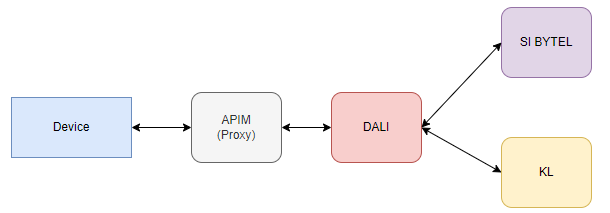{width="6.3in" height="2.1972222222222224in"}

-   Business logic with KL will be implemented on the DALI side.

-   There is no need to set up aggregation on the Device side to handle KL model data when retrieving offers.

-   DALI retrieves offers, whether subscribed or not, from the information system (IS) and enriches them with KL metadata to prepare a complete and consistent response to share with the device.

-   There is no longer a need to manage IS APIs on the device side for subscription and cancellation of offers, as DALI will handle this task.

### Life cycle of an offer

::: {#clar-off-002 .review-note}
**À clarifier / valider - CLAR-OFF-002 : états et source de vérité.** Expliciter les relations et la priorité entre `commercial.subscriptionStatus`, `entitlementState`, les variantes `entitlementStatus` / `entitlmentStatus` mentionnées dans les parcours et le statut d'activation partenaire, ainsi que les actions autorisées et le comportement UI attendu. La nature de `TRANSIENT` est clarifiée : il s'agit d'un état temporaire géré localement dans le produit, démarré par la souscription et quitté à l'expiration des 120 secondes. Ce n'est pas un statut à attendre de la réponse DALI.
:::

An offer is an object. The metadata of an offer allows it to be displayed and managed. Below is its lifecycle::

| **Status**                            | **Signification**                                          | **Possible actions** |
|------------------|-------------------------------------|------------------|
| Not subscribe                         | Cancel an offre                                            | Subscribe            |
| Subscribe                             | Subscribe to an offer                                      | unsubscribe          |
| Subscribe (real status not subscribe) | cancel an offer, but this possibility is blocked by the UI | unsubscribe          |
| include                               | Offer included by default in user subscription             | \-                   |

***[Transition between states:]{.underline}***

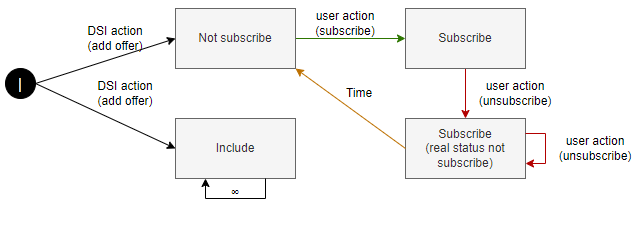{width="6.292361111111111in" height="2.236111111111111in"}

*NOTE: The included offers are not retrieved as part of nPFS, which has a UI impact compared to what is currently implemented in the legacy system, where these types of offers are displayed in the UI.*

### Global management

The main headers passed in the requests:

| **Parameter**      | **Value**                                                                                                   | **Comment**                                                                           |
|------------------|---------------------------|---------------------------|
| `Authorization`    | \"Bearer \" + \$ATK                                                                                         | Added by PFSProxy                                                                     |
| `x-kaltura-secret` | \$KS                                                                                                        | Added by PFSProxy (OPTION)                                                            |
| `x-request-id`     | \$requestId                                                                                                 | Randomly generated for each request ([RFC4122](https://www.ietf.org/rfc/rfc4122.txt)) |
| `x-version`        | 2                                                                                                           | Static, DALI API version                                                              |
| `X-User-Agent`     | \$UA                                                                                                        | Added by PFSProxy                                                                     |
| `x-message-id`     | Unique for each interaction between ST (it can be used to manage anti-replay on power supplies for example) | \-                                                                                    |
| `x-source`         | Name of the sender of the request                                                                           | \-                                                                                    |
| `Accept`           | \"application/json;charset=UTF-8\"                                                                          | N/A                                                                                   |
| `Content-Type`     | \"application/json;charset=UTF-8\"                                                                          | Only when a body is sent (POST/PUT)                                                   |

Note: \* The absence of the headers is not blocking but these headers are required for the good operability / maintainability of the service exposed on the DSI side

### Access to offer items

Use cases require the retrieval of offers from DALI:

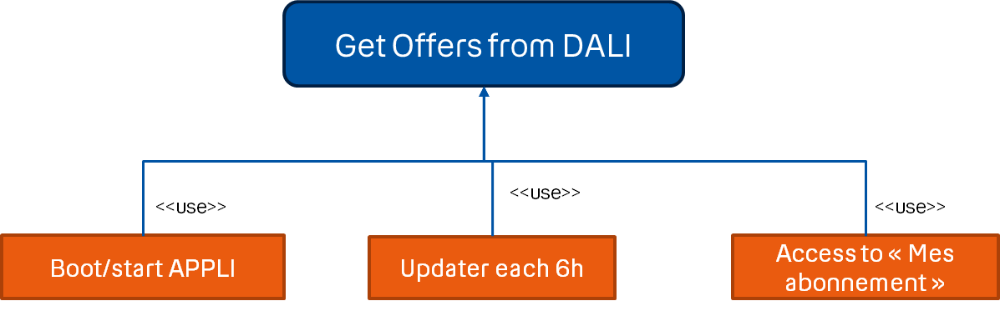{width="4.8137390638670166in" height="1.5in"}

Use cases use offer objects locally:

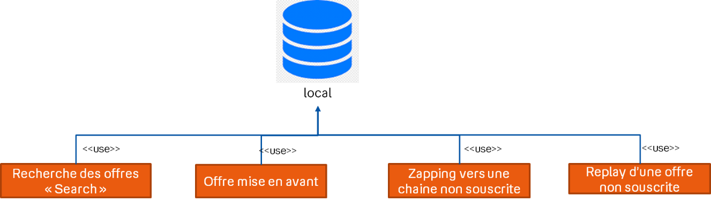{width="6.015199037620297in" height="1.7362051618547683in"}
:::

::: {.next-page .technical-content}
```{=html}
<header class="document-header">
<table aria-label="En-tête du document">
<tbody>
<tr>
<td class="brand" rowspan="4"></td>
<td class="document-kind">Spécifications Fonctionnelles</td>
<td class="metadata"></td>
</tr>
<tr>
<td class="document-title" rowspan="3">STBL - nPFS - DALI<br>Subscriptions Offers</td>
<td class="metadata">DPPS</td>
</tr>
<tr><td class="metadata">V2.2</td></tr>
<tr><td class="metadata">10/11/2026</td></tr>
</tbody>
</table>
</header>
```
# Uses cases

## Retrieving the offer list

### Triggers

-   App or STB startup.

-   Update every 6 hours with a random value between -2 hours and +2 hours.

-   Access to the \"My Subscriptions\" menu.

-   If an entitlement inconsistency is detected when zapping.

-   If PDS is modified (GET lineup return 200OK).

### Principle of offer recovery

::: {#clar-off-003 .review-note}
**À clarifier / valider - CLAR-OFF-003 : pagination, ETag et cache.** Formuler explicitement la stratégie retenue par équipement : récupération complète ou paginée, utilisation de `If-None-Match`, traitement de `200` et `304`, mise à jour des données locales et rafraîchissement forcé après souscription. Distinguer les règles applicables des explications historiques, notamment la phrase barrée dans les paramètres d'en-tête.
:::

> 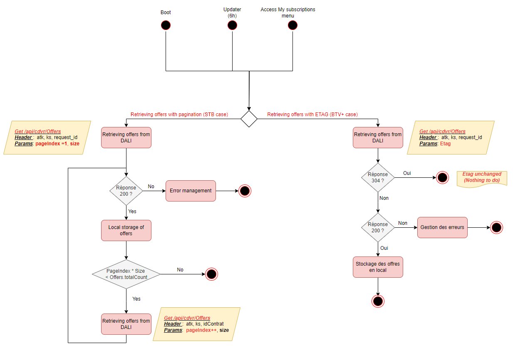{width="6.84303258967629in" height="4.678261154855643in"}

-   Pagination Branch :

    -   The pagination branch involves the device sending a request to DALI with the page number and desired page size to retrieve offer metadata.

    -   However, since « Basic » offers are not included in the offer retrieval response, which constitutes a significant amount of data to construct the entire set of offers, it is suggested to retrieve all pages with a single request and apply metadata verification based on the ETAG.

-   Etag Branch :

    -   The ETAG branch entails the device querying DALI using the ETAG as information.

    -   The ETAG is updated in the offer database with every 200 response following the offer retrieval request :

        -   For the first offer retrieval call :

            -   ETAG = ""

            -   DALI retrieves the user\'s offers and calculates the ETAG based on offer metadata, then sends the list of offers to the device with the new ETAG (HTTP 200 response) see section 4.1.3 .

            -   The device updates the old ETAG with the newly received one in the DALI response header.

        -   For subsequent offer retrieval calls,:

            -   ETAG = "xxxx"

            -   DALI retrieves the user\'s offers again, calculates the new ETAG, and then compares the two ETAGs (the one received in the request and the newly calculated one):

                -   If they are different:

                    -   DALI sends the list of offers with the new ETAG in the response header, and the device updates the ETAG in its database

                -   If they are identical:

                    -   DALI responds with HTTP 304 to indicate to the device that there is no change in comparison to the local offer metadata, and no further processing is required

### API to get offers

1)  API specification ([swagger link](https://tb3-swaggers.hprod.dali.dpps.pub.nbyt.fr/swagger/ui/offermanagement#tag/Offer-Management/operation/list))

``` http
GET /api/offers
```

(le path de l'api est défini dans le swagger)

***[Header parameters :]{.underline}***

| ***Param***                     | ***Type*** | ***Description***                                                                                                                                                                                                               |
|------------------|-----------------|--------------------------------------|
| See [3.1.3](#global-management) |            |                                                                                                                                                                                                                                 |
| `If-None-Match`                 | string     | The use of ETAG is recommended when pagination is not applied to retrieve offers. ~~However, in our situation, with STB, it is essential to note that we paginate the offer list response, so the use of ETAG does not apply.~~ |

***[Query parameters :]{.underline}***

<table>
<colgroup>
<col style="width: 24%" />
<col style="width: 23%" />
<col style="width: 53%" />
</colgroup>
<thead>
<tr class="header">
<th><em><strong>Param</strong></em></th>
<th><em><strong>Type</strong></em></th>
<th><em><strong>Description</strong></em></th>
</tr>
</thead>
<tbody>
<tr class="odd">
<td><code>category</code></td>
<td><p>String</p>
<p>Enum: "BOUQUET" "APPLICATION"  "SERVICE" "MULTIOFFER" "APPLICATION_NON_MANAGE "  </p></td>
<td><p>STB : category="BOUQUET", "APPLICATION",  "SERVICE", "MULTIOFFER", "APPLICATION_NON_MANAGE "  </p>
<p>ATV : category="BOUQUET", "SERVICE",</p>
<p>Other device category="BOUQUET", "APPLICATION",  "SERVICE", "MULTIOFFER"</p></td>
</tr>
<tr class="even">
<td><code>entitlementState</code></td>
<td><p>String</p>
<p>Enum: "ENTITLED" "NOT_ENTITLED"</p></td>
<td>In our case, this field should not be specified, as DALI will return all subscribed and unsubscribed offers.</td>
</tr>
<tr class="odd">
<td><code>page</code></td>
<td>integer</td>
<td>Page index</td>
</tr>
<tr class="even">
<td><code>size</code></td>
<td>integer</td>
<td>Page size</td>
</tr>
</tbody>
</table>

***[Response success :]{.underline}***

::: api-response
-   ***[RESPONSE HEADERS]{.underline}***

> **ETAG** : string
>
> Entity tag for current customer records list , Returned Only if pagination not used

-   ***[RESPONSE Body]{.underline}***

    -   **data** : Array

    -   **totalElements **: Integer

        -   total number of items on offer (subscribed and not subscribed)

    -   **totalPages : Integer**

        -   total pages

    -   **currentPage **:Integer

        -   index of current page

***[NOTE:]{.underline}***

-   Code 200 or 0 (PFSProxy), with no error nor empty body. Attribute \"data\" is a list of offer objects,

> and attribute storage gives related data. All data are listed in SAG. The following ones are stored. See below.

-   ***Code 304, current data in DB is used.***
:::

#### Common objects for each offer type 

::: {#clar-off-004 .review-note}
**À clarifier / valider - CLAR-OFF-004 : dictionnaire de données et catégories.** Vérifier avec le Swagger les chemins JSON exacts, leur casse, les espaces présents dans certains chemins, les types et les valeurs d'énumération. Exemples à rapprocher du contrat : `commercial.commercialType` déclaré `Integer` avec la valeur `OPTION`, `commercial.name` déclaré `Integer`, et la correspondance entre `APPLICATION_NON_MANAGE` dans les paramètres et `UNMANAGED_APPLICATION` dans les types d'offres. Les valeurs existantes sont conservées en attendant cette vérification.
:::

<table>
<colgroup>
<col style="width: 30%" />
<col style="width: 12%" />
<col style="width: 7%" />
<col style="width: 51%" />
</colgroup>
<thead>
<tr class="header">
<th><strong>Key in JSONbody.data</strong></th>
<th><strong>Type</strong></th>
<th><strong>M/O</strong></th>
<th><strong>Use</strong></th>
</tr>
</thead>
<tbody>
<tr class="odd">
<td><code>internalId</code></td>
<td><code>String</code></td>
<td>M</td>
<td>Kaltura unique identifier for DB and actions.</td>
</tr>
<tr class="even">
<td><code>id</code></td>
<td><code>String</code></td>
<td>M</td>
<td>The id used to enable Dali to make the connection between the SI Offer id and KL offer id used for DB and actions</td>
</tr>
<tr class="odd">
<td><code>category</code></td>
<td><code>String</code></td>
<td>M</td>
<td>Offer Type Used for display.</td>
</tr>
<tr class="even">
<td><code>images</code></td>
<td><code>Array</code></td>
<td>O</td>
<td>Used for display.</td>
</tr>
<tr class="odd">
<td><code>images[].id</code></td>
<td><code>String</code></td>
<td>M</td>
<td>Used for display.</td>
</tr>
<tr class="even">
<td><code>images[].allowResize</code></td>
<td><code>boolean</code></td>
<td>M</td>
<td>Used for display.</td>
</tr>
<tr class="odd">
<td><code>Images[].type</code></td>
<td><code>String</code></td>
<td>M</td>
<td>Used for display.</td>
</tr>
<tr class="even">
<td><code>Images[].height</code></td>
<td><code>Integer</code></td>
<td>O</td>
<td></td>
</tr>
<tr class="odd">
<td><code>Images[].width</code></td>
<td><code>Integer</code></td>
<td>O</td>
<td>Used for display.</td>
</tr>
<tr class="even">
<td><code>Images[].aspectRatio</code></td>
<td><code>Double</code></td>
<td>M</td>
<td>Used for display.</td>
</tr>
<tr class="odd">
<td><code>.images[]. url</code></td>
<td><code>String</code></td>
<td>M</td>
<td>Used for display.</td>
</tr>
<tr class="even">
<td><code>catalogStartDateTime</code></td>
<td><code>Integer 64</code></td>
<td>O</td>
<td>Used for display.</td>
</tr>
<tr class="odd">
<td><code>longDescription</code></td>
<td><code>String</code></td>
<td><del>O</del></td>
<td><del>Used for display.</del> (Not used)</td>
</tr>
<tr class="even">
<td><code>shortDescription</code></td>
<td><code>string</code></td>
<td>O</td>
<td>Used for display.</td>
</tr>
<tr class="odd">
<td><code>shortTitle</code></td>
<td><code>string</code></td>
<td>O</td>
<td>Offer name are used for display.</td>
</tr>
<tr class="even">
<td><code>shortName</code></td>
<td><code>String</code></td>
<td>O</td>
<td>Managed by Axis , it is used to set up Tabs in the EPG with all the channels of the offers, and the name of the Tab is the Shortname of the offer</td>
</tr>
<tr class="odd">
<td><code>longTitle</code></td>
<td><code>string</code></td>
<td><del>O</del></td>
<td><del>Description, used for display</del> (Not used)</td>
</tr>
<tr class="even">
<td><code>options []</code></td>
<td><code>Array</code></td>
<td>O</td>
<td>A table of options contains the list of rights that the user will have when subscribed to the offer.</td>
</tr>
<tr class="odd">
<td><code>options.entitledOptions[]</code></td>
<td><code>Array</code></td>
<td>M</td>
<td>Options list</td>
</tr>
<tr class="even">
<td><code>options.entitledOptions[].name</code></td>
<td><code>String</code></td>
<td>M</td>
<td>An options table The name of the option, such as in the case of nPVR, is equal to quota{nb_hours}.</td>
</tr>
<tr class="odd">
<td><code>options.entitledOptions[].status</code></td>
<td><code>Boolean</code></td>
<td>O</td>
<td>This field is optional and will contain the user's rights status for the option (true: the user has rights to the option. False: the user does not have rights).</td>
</tr>
<tr class="even">
<td><code>options.entitledOptions[].value</code></td>
<td><code>String</code></td>
<td>O</td>
<td><p>This field is optional and will contain the value of the option, such as the number of hours for the nPVR offer.</p>
<p>Note: Either the "value" field or the "status" field will be filled in a block entitled "entitledOptions".</p></td>
</tr>
<tr class="odd">
<td><code>options [].type</code></td>
<td><code>String</code></td>
<td>M</td>
<td><p>Indicates the type of option such as "nPVR" or "PassPub".</p>
<p>Since PassPub has been discontinued, only the "nPVR" type will be available as of today</p></td>
</tr>
<tr class="even">
<td><code>entitlementState</code></td>
<td><code>String</code></td>
<td>O</td>
<td><p>used to differentiate between a subscribed and unsubscribed offer and to select the type of image for the S or NS offer …</p>
<p>Not be use for unmanaged_application</p></td>
</tr>
<tr class="odd">
<td><code>genre[]</code></td>
<td><code>Array of strings</code></td>
<td>O</td>
<td>Used for display.</td>
</tr>
<tr class="even">
<td><code>editorialWeight</code></td>
<td><code>string</code></td>
<td>O</td>
<td>Used for display (Sort offers)</td>
</tr>
<tr class="odd">
<td><code>Links</code></td>
<td><p>Object</p>
<p>(HATEOAS)</p></td>
<td>O</td>
<td><p>Object that describes URLs actions linked to the offer.</p>
<p>Particularly used to make an action subscribe or cancel to an offer</p>
<p>Each LINK name is the action, and LINK.href is the URL.</p>
<p>Not to be used for unmanaged application offers</p></td>
</tr>
<tr class="even">
<td><code>Actions</code></td>
<td><p>Object</p>
<p>(HATEOAS)</p></td>
<td>O</td>
<td><p>Object that describes URLs actions on the offer.</p>
<p>Used to make subscribe, unsubscribe and to filter actions.</p>
<p>Each ACTION name is the action, and ACTION.href is the URL.</p>
<p>Example: to subscribe to this offer, call up the URL address in the actions.subscribe object</p>
<p>Not to be used for unmanaged application offers</p></td>
</tr>
</tbody>
</table>

#### « BOUQUET » type 

##### Datamodel specific to the « BOUQUET » type 

<table>
<colgroup>
<col style="width: 30%" />
<col style="width: 12%" />
<col style="width: 7%" />
<col style="width: 51%" />
</colgroup>
<thead>
<tr class="header">
<th><strong>Key in JSONbody.data</strong></th>
<th><strong>Type</strong></th>
<th><strong>M/O</strong></th>
<th><strong>Use</strong></th>
</tr>
</thead>
<tbody>
<tr class="odd">
<td><code>Commercial</code></td>
<td><code>Object</code></td>
<td>M</td>
<td>Comercial metadata</td>
</tr>
<tr class="even">
<td><code>commercial.id</code></td>
<td><code>String</code></td>
<td>M</td>
<td>Unique commercial identifier used for subscribe or unsubscribe actions</td>
</tr>
<tr class="odd">
<td><code>commercial. subscriptionStatus</code></td>
<td><code>String</code></td>
<td>M</td>
<td><p>Used to now if the offer is Active, Desactive, Activating or unspecified</p>
<p>In our case, to circumvent the DSI issues with the propagation of subscription information across various platforms (KL, etc.), we can consider the offer as subscribed as soon as we have the "Activating" status. This will allow us to update the user journey and display the "Manage my subscriptions" button instead of the "Subscribe" button.</p></td>
</tr>
<tr class="even">
<td><code>commercial.commercialType</code></td>
<td><code>Integer</code></td>
<td>M</td>
<td><p>Offer type from a commercial point of view</p>
<p>Known values: OPTION, ...</p>
<p>Used for display.</p></td>
</tr>
<tr class="odd">
<td><code>commercial.name</code></td>
<td><code>Integer</code></td>
<td>O</td>
<td>Commercial wording of an offer</td>
</tr>
<tr class="even">
<td><code>commercial .originalAmount</code></td>
<td><code>float</code></td>
<td>M</td>
<td><p>Offer price before promotion.</p>
<p>Used for display.</p></td>
</tr>
<tr class="odd">
<td><code>commercial.finalAmount</code></td>
<td><code>float</code></td>
<td>M</td>
<td><p>Used to be compared with originalAmount, and then for display in function of the result (See UI Part).</p>
<p>Offer price with promotion</p>
<p>Used for display.</p>
<p>Used for the rules to promotion display (Ex: finalAmount+”euros”)</p></td>
</tr>
<tr class="even">
<td><code>Commercial.promotions</code></td>
<td><code>Array</code></td>
<td>O</td>
<td>Object describe the promotion</td>
</tr>
<tr class="odd">
<td><code>commercial.promotions[i]. price</code></td>
<td><code>Integer 64</code></td>
<td>M</td>
<td>Object describes the promotions applied to the offer, used for display</td>
</tr>
<tr class="even">
<td><code>commercial.promotions[i].order</code></td>
<td><code>Integer</code></td>
<td>O</td>
<td><p>Order of application of discounts when there are several promotions on offer.</p>
<p>Used to determinate the promotion applied to the offer and display</p></td>
</tr>
<tr class="odd">
<td><code>commercial.promotions[i].applyTill</code></td>
<td><code>Integer 64</code></td>
<td>O</td>
<td>Used for display.</td>
</tr>
<tr class="even">
<td><code>commercial.promotions[i].expirationDate</code></td>
<td><code>Integer 64</code></td>
<td>O</td>
<td>Used for display</td>
</tr>
<tr class="odd">
<td><code>commercial.promotions[i]. duration</code></td>
<td><code>Object</code></td>
<td>O</td>
<td>Used for display.</td>
</tr>
<tr class="even">
<td><code>commercial.promotions[i]. duration. durationType</code></td>
<td><code>String</code></td>
<td>O</td>
<td><p>Duration Unit (Day, month, Year), used for display</p>
<ul>
<li><p>one_time : The discount stays attached to the subscription till it is applied on an invoice once. It is removed after that from the subscription.</p></li>
<li><p>forever : The discount is attached to the subscription and applied on the invoices till it is explicitly removed.</p></li>
<li><p>limited_period : The discount is attached to the subscription and applied on the invoices for a limited duration. This duration starts from the point it is applied to an invoice for the first time and expires after a period specified by period and period_unit</p></li>
</ul></td>
</tr>
<tr class="odd">
<td><code>commercial.promotions[i]. duration. period</code></td>
<td><code>Integer</code></td>
<td>O</td>
<td>Duration period, min=1 The duration of time for which the discount is attached to the subscription, in period_units. Applicable only when duration_type is limited_period used for display</td>
</tr>
<tr class="even">
<td><code>commercial.promotions[i]. duration. periodUnit</code></td>
<td><code>String</code></td>
<td>O</td>
<td>The unit of time for period. Applicable only when duration_type is limited_period. Possible values are : day – A period of 24 hours. month – A period of 1 calendar month. year – A period of 1 calendar year (maybe used to display the period of the promotion)</td>
</tr>
<tr class="odd">
<td><code>Commercial. promotionalDescription</code></td>
<td><code>String</code></td>
<td>O</td>
<td>Used for display (not used to day)</td>
</tr>
<tr class="even">
<td><code>Commercial.startDate</code></td>
<td><code>Int64</code></td>
<td>O</td>
<td>Not used</td>
</tr>
<tr class="odd">
<td><code>Commercial.endDate</code></td>
<td><code>In64</code></td>
<td>O</td>
<td>Used for Display</td>
</tr>
<tr class="even">
<td><code>parentalRating</code></td>
<td><code>Integer</code></td>
<td>M</td>
<td>Display or not the offer</td>
</tr>
<tr class="odd">
<td><code>trailerNonSubscribedOffers[]</code></td>
<td><code>Array of Strings</code></td>
<td>O</td>
<td><p>Link to the baker channel</p>
<p>Used for display when we zap in the live channel</p></td>
</tr>
<tr class="even">
<td><code>replayShop</code></td>
<td><code>Object</code></td>
<td>M</td>
<td>Used to display the scup row</td>
</tr>
<tr class="odd">
<td><code>replayShop.total</code></td>
<td><code>Integer</code></td>
<td>M</td>
<td>Total of cup shop used for display</td>
</tr>
<tr class="even">
<td><code>replayShop. items</code></td>
<td><code>Array</code></td>
<td>O</td>
<td>List of cup shop used for display</td>
</tr>
<tr class="odd">
<td><code>replayShop. Items[i].id</code></td>
<td><code>String</code></td>
<td>M</td>
<td>Cup shop kl collection id, not used at to day</td>
</tr>
<tr class="even">
<td><code>replayShop. Items[i].name</code></td>
<td><code>String</code></td>
<td>M</td>
<td>Cup shop kl collection id, not used at to day</td>
</tr>
<tr class="odd">
<td><code>replayShop. Items[i].providerId</code></td>
<td><code>String</code></td>
<td>M</td>
<td>Used for display (retrieves the scup shop thumbnail from axis)</td>
</tr>
<tr class="even">
<td><code>replayShop. Items[i].channels</code></td>
<td><code>Array</code></td>
<td>M</td>
<td><p>List of channels associated to this CUP shop, used for display.</p>
<p>Note: this list of channels will be set by DALI in the live shop object.</p>
<p>To display the row scup, you only need the channel lcn.</p></td>
</tr>
<tr class="odd">
<td><code>replayShop. Items[i].channels[j].id</code></td>
<td><code>String</code></td>
<td>M</td>
<td>Channel id, not used at the day</td>
</tr>
<tr class="even">
<td><code>replayShop. Items[i].channels[j].name</code></td>
<td><code>String</code></td>
<td>M</td>
<td>Channel name, not used at the day</td>
</tr>
<tr class="odd">
<td><code>replayShop. Items[i].channels[j].lcn</code></td>
<td><code>String</code></td>
<td>Integer</td>
<td>Lcn used for display</td>
</tr>
<tr class="even">
<td><code>svodShop</code></td>
<td><code>Object</code></td>
<td>O</td>
<td>Used to display the svod row</td>
</tr>
<tr class="odd">
<td><code>svodShop.total</code></td>
<td><code>Integer</code></td>
<td>M</td>
<td>Total of vod shop used for display</td>
</tr>
<tr class="even">
<td><code>svodShop. items</code></td>
<td><code>Array</code></td>
<td>O</td>
<td>List of vod shop used for display</td>
</tr>
<tr class="odd">
<td><code>svodShop. Items[i].id</code></td>
<td><code>String</code></td>
<td>M</td>
<td>vod shop kl collection id, not used at to day</td>
</tr>
<tr class="even">
<td><code>svodShop. Items[i].name</code></td>
<td><code>String</code></td>
<td>M</td>
<td>vod shop kl collection id, not used at to day</td>
</tr>
<tr class="odd">
<td><code>svodShop. Items[i].providerId</code></td>
<td><code>String</code></td>
<td>M</td>
<td>Used for display (retrieves the svod shop thumbnail from axis)</td>
</tr>
<tr class="even">
<td><code>liveShop</code></td>
<td><code>Object</code></td>
<td>O</td>
<td>Used to display the live shop row row</td>
</tr>
<tr class="odd">
<td><code>liveShop.total</code></td>
<td><code>Integer</code></td>
<td>M</td>
<td>Total of channels used for display</td>
</tr>
<tr class="even">
<td><code>liveShop. items</code></td>
<td><code>Array</code></td>
<td>O</td>
<td>List of channels used for display</td>
</tr>
<tr class="odd">
<td><code>liveShop. Items[i].id</code></td>
<td><code>String</code></td>
<td>M</td>
<td>Linear asset id used to get channel thumbnail from the pds</td>
</tr>
<tr class="even">
<td><code>liveShop. Items[i].name</code></td>
<td><code>String</code></td>
<td>M</td>
<td>Linear asset id, not used</td>
</tr>
<tr class="odd">
<td><code>liveShop. Items[i].lcn</code></td>
<td><code>Integer</code></td>
<td>O</td>
<td>Linear asset lcn, used for display</td>
</tr>
<tr class="even">
<td><code>liveShop. Items[i].collections</code></td>
<td><code>Array</code></td>
<td>M</td>
<td><p>The collection in which the linear asset is associated</p>
<p>the idea is to know if the channel is associated with a scupshop or not</p></td>
</tr>
<tr class="odd">
<td><code>liveShop. Items[i].collections [j].id</code></td>
<td><code>String</code></td>
<td>M</td>
<td>Collection KL id not used</td>
</tr>
<tr class="even">
<td><code>liveShop. Items[i].collections [j].type</code></td>
<td><code>String</code></td>
<td>M</td>
<td>Collection KL type (CUP_SHOP, VOD_SHOP or LIVE_SHOP), not used</td>
</tr>
<tr class="odd">
<td><code>liveShop. Items[i].collections [j].name</code></td>
<td><code>string</code></td>
<td>M</td>
<td>Collection KL name, not used</td>
</tr>
</tbody>
</table>

##### ²Using metadata for the UI interface

1)  Several offers associated to the channel (Offer with promotion)

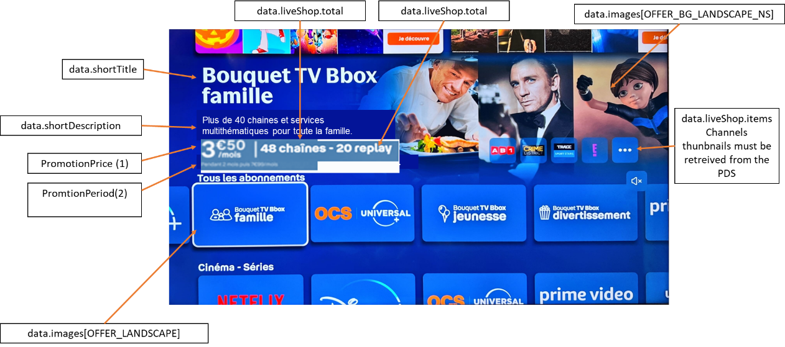{width="5.6910804899387575in" height="2.5214730971128607in"}

**[v]{.underline}**

2)  Several offers associated to the channel (Offer without promotion)

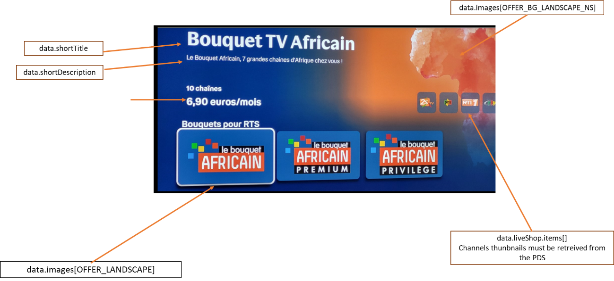{width="5.8578357392825895in" height="2.687117235345582in"}

3)  Unsubscribed offer info page with promotion

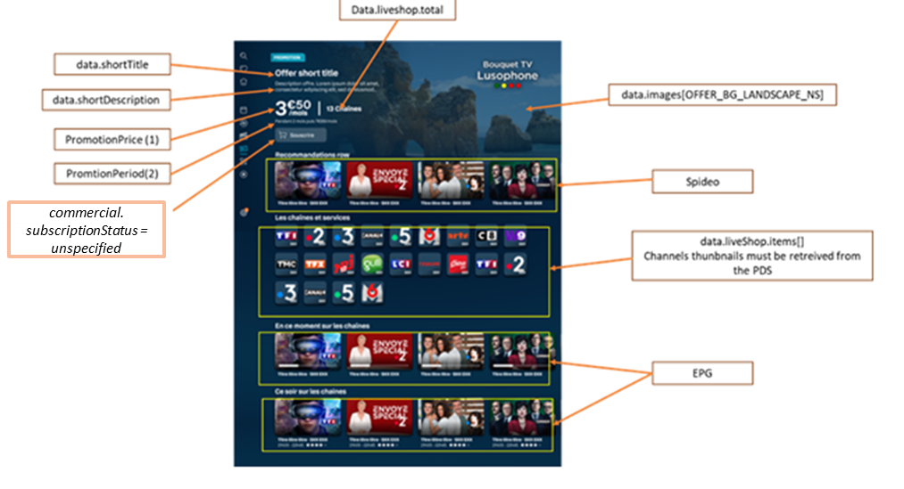{width="6.754166666666666in" height="3.660416666666667in"}

See section (a) for more details for promotionPrice and PromotionPeriod

a.  Unsubscribed offer info page without promotion

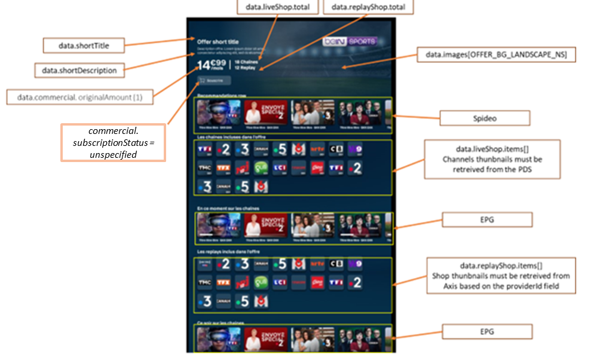{width="6.59375in" height="3.9472222222222224in"}

d.  subscribed offer info page

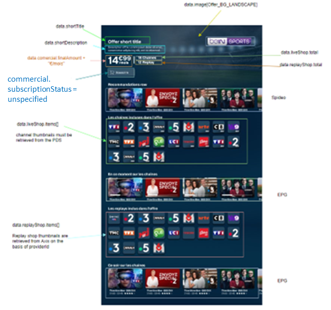{width="4.373611111111111in" height="4.100694444444445in"}

#### « APPLICATION » type (partner offers D+, DORCEL,...)

##### Datamodel specific to the « APPLICATION » type 

<table>
<colgroup>
<col style="width: 30%" />
<col style="width: 12%" />
<col style="width: 7%" />
<col style="width: 51%" />
</colgroup>
<thead>
<tr class="header">
<th><strong>Key in JSONbody.data</strong></th>
<th><strong>Type</strong></th>
<th><strong>M/O</strong></th>
<th><strong>Use</strong></th>
</tr>
</thead>
<tbody>
<tr class="odd">
<td><code>commercial</code></td>
<td><code>Object</code></td>
<td>M</td>
<td>Comercial metadata</td>
</tr>
<tr class="even">
<td><code>commercial.id</code></td>
<td><code>String</code></td>
<td>M</td>
<td>Unique commercial identifier used for subscribe or unsubscribe actions</td>
</tr>
<tr class="odd">
<td><code>commercial. subscriptionStatus</code></td>
<td><code>String</code></td>
<td>M</td>
<td>Used to now if the offer is Active, Desactivating, Activating or unspecified</td>
</tr>
<tr class="even">
<td><code>commercial.Partner</code></td>
<td><code>Object</code></td>
<td>O</td>
<td>It contains the activation status of the partner offer.</td>
</tr>
<tr class="odd">
<td><code>commercial.Partner.id</code></td>
<td><code>string</code></td>
<td>O</td>
<td>Identifier of the partner</td>
</tr>
<tr class="even">
<td><code>commercial.Partner.status</code></td>
<td><code>String</code></td>
<td>M</td>
<td>Status of the account creation in partner side , possible values : ACTIVE, CANCELED, CREATED, INACTIVE, NON-EXISTENT, UNSUBSCRIBED</td>
</tr>
<tr class="odd">
<td><code>commercial.commercialType</code></td>
<td><code>Integer</code></td>
<td>M</td>
<td><p>Offer type from a commercial point of view</p>
<p>Known values: OPTION, BONUS, "OFFERED_SERVICE" "PARTNER_SERVICE".</p>
<p>NOT used.</p></td>
</tr>
<tr class="even">
<td><code>commercial.name</code></td>
<td><code>Integer</code></td>
<td>O</td>
<td>Commercial wording of an offer</td>
</tr>
<tr class="odd">
<td><code>commercial .originalAmount</code></td>
<td><code>float</code></td>
<td>M</td>
<td><p>Offer price before promotion.</p>
<p>Used for display.</p></td>
</tr>
<tr class="even">
<td><code>commercial.finalAmount</code></td>
<td><code>float</code></td>
<td>M</td>
<td><p>Used to be compared with originalAmount, and then for display in function of the result (See UI Part).</p>
<p>Offer price with promotion</p>
<p>Used for display.</p>
<p>Used for the rules to promotion display (Ex: finalAmount+”euros”)</p></td>
</tr>
<tr class="odd">
<td><code>Commercial.promotions</code></td>
<td><code>Array</code></td>
<td>O</td>
<td>Object describe the promotion</td>
</tr>
<tr class="even">
<td><code>commercial.promotions[i]. price</code></td>
<td><code>Integer 64</code></td>
<td>M</td>
<td>Object describes the promotions applied to the offer, used for display</td>
</tr>
<tr class="odd">
<td><code>commercial.promotions[i].order</code></td>
<td><code>Integer</code></td>
<td>O</td>
<td><p>Order of application of discounts when there are several promotions on offer.</p>
<p>Used to determinate the promotion applied to the offer and display</p></td>
</tr>
<tr class="even">
<td><code>commercial.promotions[i].applyTill</code></td>
<td><code>Integer 64</code></td>
<td>O</td>
<td>Used for display.</td>
</tr>
<tr class="odd">
<td><code>commercial.promotions[i].expirationDate</code></td>
<td><code>Integer 64</code></td>
<td>O</td>
<td>Used for display</td>
</tr>
<tr class="even">
<td><code>commercial.promotions[i]. duration</code></td>
<td><code>Object</code></td>
<td>O</td>
<td>Used for display.</td>
</tr>
<tr class="odd">
<td><code>commercial.promotions[i]. duration. durationType</code></td>
<td><code>String</code></td>
<td>O</td>
<td><p>Duration Unit (Day, month, Year), used for display</p>
<ul>
<li><p>one_time : The discount stays attached to the subscription till it is applied on an invoice once. It is removed after that from the subscription.</p></li>
<li><p>forever : The discount is attached to the subscription and applied on the invoices till it is explicitly removed.</p></li>
<li><p>limited_period : The discount is attached to the subscription and applied on the invoices for a limited duration. This duration starts from the point it is applied to an invoice for the first time and expires after a period specified by period and period_unit</p></li>
</ul></td>
</tr>
<tr class="even">
<td><code>commercial.promotions[i]. duration. period</code></td>
<td><code>Integer</code></td>
<td>O</td>
<td>Duration period, min=1 The duration of time for which the discount is attached to the subscription, in period_units. Applicable only when duration_type is limited_period used for display</td>
</tr>
<tr class="odd">
<td><code>commercial.promotions[i]. duration. periodUnit</code></td>
<td><code>String</code></td>
<td>O</td>
<td>The unit of time for period. Applicable only when duration_type is limited_period. Possible values are : day – A period of 24 hours. month – A period of 1 calendar month. year – A period of 1 calendar year (maybe used to display the period of the promotion)</td>
</tr>
<tr class="even">
<td><code>Commercial. promotionalDescription</code></td>
<td><code>String</code></td>
<td>O</td>
<td>Used for display (not used to day)</td>
</tr>
<tr class="odd">
<td><code>Commercial.startDate</code></td>
<td><code>Int64</code></td>
<td>O</td>
<td>Not used</td>
</tr>
<tr class="even">
<td><code>Commercial.endDate</code></td>
<td><code>In64</code></td>
<td>O</td>
<td>Used for Display</td>
</tr>
<tr class="odd">
<td><code>partnerOfferUrl</code></td>
<td><code>String</code></td>
<td>O</td>
<td>Used for display</td>
</tr>
<tr class="even">
<td><code>partnerOfferApk</code></td>
<td><code>String</code></td>
<td>O</td>
<td>Used for display</td>
</tr>
<tr class="odd">
<td><code>parentalRating</code></td>
<td><code>Integer</code></td>
<td>M</td>
<td>Display or not the offer</td>
</tr>
<tr class="even">
<td><code>trailerNonSubscribedOffers[]</code></td>
<td><code>Array of Strings</code></td>
<td>O</td>
<td><p>Link to the baker channel</p>
<p>Used for display when we zap in the live channel</p></td>
</tr>
<tr class="odd">
<td><code>relatedBoutique</code></td>
<td><code>String</code></td>
<td>O</td>
<td>Contains the id of the collection associated with the application, not used by FE</td>
</tr>
<tr class="even">
<td><code>subscriptionType</code></td>
<td><code>Int</code></td>
<td>O</td>
<td>'Subscription type used' is used to determine the type of offer - fluid, non-fluid, etc.</td>
</tr>
<tr class="odd">
<td><code>activationLink</code></td>
<td><code>String</code></td>
<td>O</td>
<td><p>The deeplink or QR Code contains the path to activate the account on the app .</p>
<p>The QR Code and the deep link are computed by DALI, and the device should use them as such.</p></td>
</tr>
<tr class="even">
<td><code>finalActivationLink</code></td>
<td><code>String</code></td>
<td>O</td>
<td><p>Activation Link to be called by devices Computed by DALI</p>
<p>The QR Code and the deep link are computed by DALI, and the device should use them as such.</p>
<p>The finalActivationLink will only be provided in the response from DALI following a subscription. Therefore, this field should be saved once in the offer database and should not be updated after a get or list call, as the finalActivationLink will not be included in the return of these APIs</p></td>
</tr>
<tr class="odd">
<td><code>infoPageTemplate</code></td>
<td><code>Int</code></td>
<td>O</td>
<td>Not used for the moment. The info page template will be shared with axis</td>
</tr>
<tr class="even">
<td><code>hide</code></td>
<td><code>Boolean</code></td>
<td>O</td>
<td>This is used for technical offers that should not be displayed.</td>
</tr>
</tbody>
</table>

##### User journey

::: {#clar-off-005 .review-note}
**À clarifier / valider - CLAR-OFF-005 : disponibilité du lien d'activation.** Préciser comment le parcours retrouve `finalActivationLink` à chaque consultation alors que le modèle indique que ce champ n'est fourni qu'après une souscription et doit être conservé localement. Expliciter le comportement en cas d'absence du lien dans le cache, de redémarrage ou d'expiration, ainsi que son articulation avec `activationLink`, sans changer le parcours validé.
:::

> **[What changes compared to the legacy version:]{.underline}**
>
> There is no specific AIBO API to determine the activation status, instead one must call the DALI getOffer API with the commercial offer ID to obtain the activation status. The activation status is found in the commercial object returned by DALI in the Partner object.

**[Call flow :]{.underline}**

> Note: With each entry to display the information of an offer, we must apply this call flow.

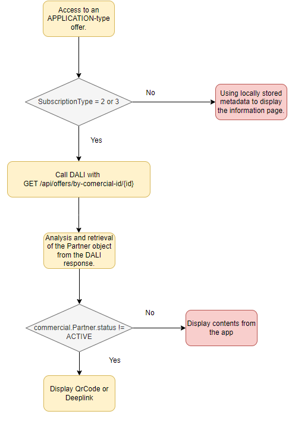{width="3.462264873140857in" height="5.09156605424322in"}

-   If the user accesses an APPLICATION-type offer

    -   We must check the subscription type data.subscriptionType.

        -   If data.subscriptionType=2 or 3, then we must know the activation status of the offer:

            -   To determine the activation status of an offer, it is necessary to call DALI with the \"get\" API for the offers by specifying the ID of the relevant offer.

                -   The response to this request will contain a \"commercial.Partner\" object, which will indicate the activation status to adjust the user journey accordingly - field described in the table above:

                    -   If the commercial.Partner.status is different from \'ACTIVE\', then the QRCode (data.subscriptionType=2 as Disney+) or application thumbnail/deeplink that redirects to the account creation page (data.subscriptionType=3 as DORCEL) must be displayed.

                        -   The QR Code or the deep link is sent by DALI in the metadata : finalActivationLink

                    -   ACTIVE status: The \"Your service to activate\" row (which contains the QRCode or deeplink for account creation) must be hidden in the offer information sheet.

> **[DALI API]{.underline}**

2)  API specification ([swagger link](https://tb3-swaggers.hprod.dali.dpps.pub.nbyt.fr/swagger/ui/offermanagement#tag/Offer-Management/operation/list))

``` http
GET /api/offers/by-commercial-id/{commercialId}
```

::: {#clar-off-006 .review-note}
**À clarifier / valider - CLAR-OFF-006 : réponse de la consultation unitaire.** Vérifier avec le Swagger la forme exacte de la réponse de cette API appelée avec un identifiant commercial : objet unique ou collection, présence de `totalElements`, `totalPages` et `currentPage`, et chemin exact du statut partenaire. La description actuelle de la réponse est conservée jusqu'à validation du contrat.
:::

(le path de l'api est défini dans le swagger)

***[Header parameters :]{.underline}***

| ***Param***                     | ***Type*** | ***Description*** |
|---------------------------------|------------|-------------------|
| See [3.1.3](#global-management) |            |                   |

***[Response success :]{.underline}***

::: api-response
-   ***[RESPONSE Body]{.underline}***

    -   **data** : Array Data contains the entire table defined in (a).

    -   **totalElements **: Integer

        -   total number of items on offer (subscribed and not subscribed)

    -   **totalPages : Integer**

        -   total pages

    -   **currentPage **:Integer

        -   index of current page

***[NOTE:]{.underline}***

-   Code 200 or 0 (PFSProxy), with no error nor empty body. Attribute \"data\" is a list of offer objects,

> and attribute storage gives related data. All data are listed in SAG. The following ones are stored. See below.
:::

**[Subscribe/unsubscribe :]{.underline}**

> There is no impact on the devices for managing the subscription and cancellation of partner offers. The same request and principle as for bouquet offers is applied for subscription and cancellation. DALI chooses which subscription API to call based on the type of offer - fluid or non-fluid.

##### Management of fluid and non-fluid offers {#management-of-fluid-and-non-fluid-offers.}

::: {#clar-off-007 .review-note}
**À clarifier / valider - CLAR-OFF-007 : activation des offres partenaires.** Rendre explicite la matrice `subscriptionType` / statut commercial / statut partenaire / actions UI, notamment pour le type `3` non activé auquel une nouvelle souscription est proposée. Préciser la portée de la limite d'un appel toutes les 5 secondes et le comportement à l'expiration du lien valable une heure. Il s'agit de documenter précisément les règles déjà validées, non de les remplacer.
:::

-   Non-fluid offer (as Disney+)

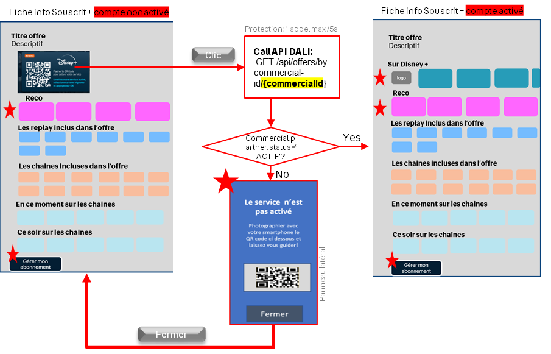{width="5.4333508311461065in" height="3.4879997812773404in"}

> After subscribing to the (Disney+) offer (with subscriptionType=2 ) through the Bytel UI, the subscription status returned by the SI via DALI will be active and the data.entitlmentStatus = ENTITLED, even though the account may not be activated. In this situation, we need to check the account activation status to adjust the journey correctly.
>
> The user has the option to click on the QR Code as described in the schema. In this case, we should call the DALI get API to obtain the account activation status. We maintain the same protection as the legacy with 1 get call per 5 seconds.

-   fluid offer (as DORCEL)

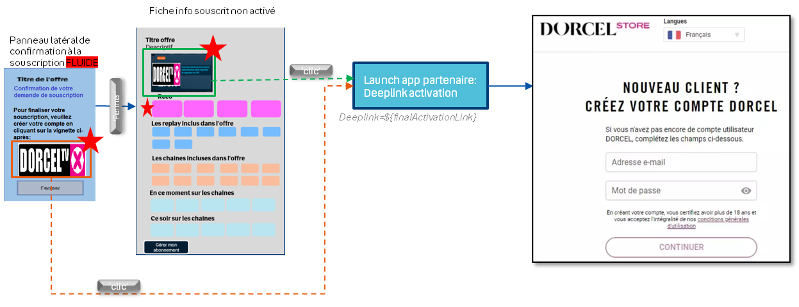{width="6.268443788276466in" height="2.4079997812773404in"}

> After a user subscribes to this type of offer (data.subscriptionType = 3), such as the DORCEL offer, the user must activate their account via the deep link provided in the UI (the deep link is defined in data.finalActivationLink). This deep link remains valid for one hour, and the subscription status remains DEACTIVATING with data.entitlementStatus = NOT_ENTITLED until the user activates their account.
>
> To simplify the management of this type of offer on the device side without taking into account the deep link\'s validity period, we should rely on the user\'s subscription status:

-   If data.subscriptionType=3 and commercial.partner.status != ACTIVE, then we offer the user to subscribe to the offer even if they have been subscribed for less than an hour.

####  « UNMANAGED_APPLICATION » type (Canal+)

##### Datamodel specific to the « UNMANAGED_APPLICATION » type 

<table>
<colgroup>
<col style="width: 30%" />
<col style="width: 12%" />
<col style="width: 7%" />
<col style="width: 51%" />
</colgroup>
<thead>
<tr class="header">
<th><strong>Key in JSONbody.data</strong></th>
<th><strong>Type</strong></th>
<th><strong>M/O</strong></th>
<th><strong>Use</strong></th>
</tr>
</thead>
<tbody>
<tr class="odd">
<td><code>partnerOfferUrl</code></td>
<td><code>String</code></td>
<td>O</td>
<td>Used for display</td>
</tr>
<tr class="even">
<td><code>partnerOfferApk</code></td>
<td><code>String</code></td>
<td>O</td>
<td>Used for display</td>
</tr>
<tr class="odd">
<td><code>parentalRating</code></td>
<td><code>Integer</code></td>
<td>M</td>
<td>Display or not the offer</td>
</tr>
<tr class="even">
<td><code>trailerNonSubscribedOffers[]</code></td>
<td><code>Array of Strings</code></td>
<td>O</td>
<td><p>Link to the baker channel</p>
<p>Used for display when we zap in the live channel</p></td>
</tr>
<tr class="odd">
<td><code>relatedBoutique</code></td>
<td><code>String</code></td>
<td>O</td>
<td>Contains the id of the collection associated with the application, not used by FE</td>
</tr>
<tr class="even">
<td><code>hide</code></td>
<td><code>Boolean</code></td>
<td>O</td>
<td>This is used for technical offers that should not be displayed.</td>
</tr>
</tbody>
</table>

This offer is only eligible for the STB device and is not listed in the offers defined on the DSI side. Therefore, it is necissary to specify the categories of offers supported by the device in the request for obtaining the list of subscribed and unsubscribed offers.

For example, if the device wants to retrieve Canal offers in the list of subscribable offers, it must add the category=UNMANAGED_APPLICATION query parameter to the request.

For other devices that do not support Canal applications and applications not managed by the DSI, the category UNMANAGED_APPLICATION should not be added to the request.

This type of offer can only be subscribed to from the partner app, such as Canal+.

#### Datamodel specific to the « SERVICE » type 

<table>
<colgroup>
<col style="width: 30%" />
<col style="width: 12%" />
<col style="width: 7%" />
<col style="width: 51%" />
</colgroup>
<thead>
<tr class="header">
<th><strong>Key in JSONbody.data</strong></th>
<th><strong>Type</strong></th>
<th><strong>M/O</strong></th>
<th><strong>Use</strong></th>
</tr>
</thead>
<tbody>
<tr class="odd">
<td><code>commercial</code></td>
<td><code>Object</code></td>
<td>M</td>
<td>Comercial metadata</td>
</tr>
<tr class="even">
<td><code>commercial.id</code></td>
<td><code>String</code></td>
<td>M</td>
<td>Unique commercial identifier used for subscribe or unsubscribe actions</td>
</tr>
<tr class="odd">
<td><code>commercial. subscriptionStatus</code></td>
<td><code>String</code></td>
<td>M</td>
<td>Used to now if the offer is Active, Desactive, Activating or unspecified</td>
</tr>
<tr class="even">
<td><code>commercial.commercialType</code></td>
<td><code>Integer</code></td>
<td>M</td>
<td><p>Offer type from a commercial point of view</p>
<p>Known values: OPTION, ...</p>
<p>Used for display.</p></td>
</tr>
<tr class="odd">
<td><code>commercial.name</code></td>
<td><code>Integer</code></td>
<td>O</td>
<td>Commercial wording of an offer</td>
</tr>
<tr class="even">
<td><code>commercial .originalAmount</code></td>
<td><code>float</code></td>
<td>M</td>
<td><p>Offer price before promotion.</p>
<p>Used for display.</p></td>
</tr>
<tr class="odd">
<td><code>commercial.finalAmount</code></td>
<td><code>float</code></td>
<td>M</td>
<td><p>Used to be compared with originalAmount, and then for display in function of the result (See UI Part).</p>
<p>Offer price with promotion</p>
<p>Used for display.</p>
<p>Used for the rules to promotion display (Ex: finalAmount+”euros”)</p></td>
</tr>
<tr class="even">
<td><code>Commercial.promotions</code></td>
<td><code>Array</code></td>
<td>O</td>
<td>Object describe the promotion</td>
</tr>
<tr class="odd">
<td><code>commercial.promotions[i]. price</code></td>
<td><code>Integer 64</code></td>
<td>M</td>
<td>Object describes the promotions applied to the offer, used for display</td>
</tr>
<tr class="even">
<td><code>commercial.promotions[i].order</code></td>
<td><code>Integer</code></td>
<td>O</td>
<td><p>Order of application of discounts when there are several promotions on offer.</p>
<p>Used to determinate the promotion applied to the offer and display</p></td>
</tr>
<tr class="odd">
<td><code>commercial.promotions[i].applyTill</code></td>
<td><code>Integer 64</code></td>
<td>O</td>
<td>Used for display.</td>
</tr>
<tr class="even">
<td><code>commercial.promotions[i].expirationDate</code></td>
<td><code>Integer 64</code></td>
<td>O</td>
<td>Used for display</td>
</tr>
<tr class="odd">
<td><code>commercial.promotions[i]. duration</code></td>
<td><code>Object</code></td>
<td>O</td>
<td>Used for display.</td>
</tr>
<tr class="even">
<td><code>commercial.promotions[i]. duration. durationType</code></td>
<td><code>String</code></td>
<td>O</td>
<td><p>Duration Unit (Day, month, Year), used for display</p>
<ul>
<li><p>one_time : The discount stays attached to the subscription till it is applied on an invoice once. It is removed after that from the subscription.</p></li>
<li><p>forever : The discount is attached to the subscription and applied on the invoices till it is explicitly removed.</p></li>
<li><p>limited_period : The discount is attached to the subscription and applied on the invoices for a limited duration. This duration starts from the point it is applied to an invoice for the first time and expires after a period specified by period and period_unit</p></li>
</ul></td>
</tr>
<tr class="odd">
<td><code>commercial.promotions[i]. duration. period</code></td>
<td><code>Integer</code></td>
<td>O</td>
<td>Duration period, min=1 The duration of time for which the discount is attached to the subscription, in period_units. Applicable only when duration_type is limited_period used for display</td>
</tr>
<tr class="even">
<td><code>commercial.promotions[i]. duration. periodUnit</code></td>
<td><code>String</code></td>
<td>O</td>
<td>The unit of time for period. Applicable only when duration_type is limited_period. Possible values are : day – A period of 24 hours. month – A period of 1 calendar month. year – A period of 1 calendar year (maybe used to display the period of the promotion)</td>
</tr>
<tr class="odd">
<td><code>Commercial. promotionalDescription</code></td>
<td><code>String</code></td>
<td>O</td>
<td>Used for display (not used to day)</td>
</tr>
<tr class="even">
<td><code>Commercial.startDate</code></td>
<td><code>Int64</code></td>
<td>O</td>
<td>Not used</td>
</tr>
<tr class="odd">
<td><code>Commercial.endDate</code></td>
<td><code>In64</code></td>
<td>O</td>
<td>Used for Display</td>
</tr>
<tr class="even">
<td><code>relatedBoutique</code></td>
<td><code>String</code></td>
<td>O</td>
<td>Contains the id of the collection associated with the application, not used by FE</td>
</tr>
</tbody>
</table>

##### nPVR offer

As indicated in paragraph 4.1.3.1, there will be a table of option objects through which we can determine the type of the service offer is nPVR or not unsing the metadata "options\[\].type" = "nPVR".

Following the retrieval of an \"nPVR\" offer via the get and list APIs exposed by DALI, the structure of the option field is as follows:

| ***Field***                             | ***type*** | ***M/O*** | ***Value***     |
|----------------------|----------|------|------------------------------------|
| `data.options []`                       | `Array`    | O         | \-              |
| `data.options.entitledOptions[]`        | `Array`    | M         | \-              |
| `data.options.entitledOptions[].name`   | `String`   | M         | quota{nb_hours} |
| `data.options.entitledOptions[].status` | `Boolean`  | O         | NULL            |
| `data.options.entitledOptions[].value`  | `String`   | O         | {nb_hours}      |
| `data.options [].type`                  | `String`   | M         | "nPVR"          |

This object must be stored in the local offer database to be utilized by the UI according to marketing needs. Through the metadata returned by DALI following the \"list\" API call, we can distinguish:

-   The type of offer, whether nPVR or not, via options\[\].type

-   The subscription status via data.entitlementState

-   The quota of the nPVR offer via data.options.entitledOptions\[\].value

#### Datamodel specific to the « MULTIOFFER » type 

<table>
<colgroup>
<col style="width: 30%" />
<col style="width: 12%" />
<col style="width: 7%" />
<col style="width: 51%" />
</colgroup>
<thead>
<tr class="header">
<th><strong>Key in JSONbody.data</strong></th>
<th><strong>Type</strong></th>
<th><strong>M/O</strong></th>
<th><strong>Use</strong></th>
</tr>
</thead>
<tbody>
<tr class="odd">
<td><code>commercial</code></td>
<td><code>Object</code></td>
<td>M</td>
<td>Comercial metadata</td>
</tr>
<tr class="even">
<td><code>commercial.id</code></td>
<td><code>String</code></td>
<td>M</td>
<td>Unique commercial identifier used for subscribe or unsubscribe actions</td>
</tr>
<tr class="odd">
<td><code>commercial. subscriptionStatus</code></td>
<td><code>String</code></td>
<td>M</td>
<td>Used to now if the offer is Active, Desactive, Activating or unspecified</td>
</tr>
<tr class="even">
<td><code>commercial.commercialType</code></td>
<td><code>Integer</code></td>
<td>M</td>
<td><p>Offer type from a commercial point of view</p>
<p>Known values: OPTION, ...</p>
<p>Used for display.</p></td>
</tr>
<tr class="odd">
<td><code>commercial.name</code></td>
<td><code>Integer</code></td>
<td>O</td>
<td>Commercial wording of an offer</td>
</tr>
<tr class="even">
<td><code>commercial .originalAmount</code></td>
<td><code>float</code></td>
<td>M</td>
<td><p>Offer price before promotion.</p>
<p>Used for display.</p></td>
</tr>
<tr class="odd">
<td><code>commercial.finalAmount</code></td>
<td><code>float</code></td>
<td>M</td>
<td><p>Used to be compared with originalAmount, and then for display in function of the result (See UI Part).</p>
<p>Offer price with promotion</p>
<p>Used for display.</p>
<p>Used for the rules to promotion display (Ex: finalAmount+”euros”)</p></td>
</tr>
<tr class="even">
<td><code>Commercial.promotions</code></td>
<td><code>Array</code></td>
<td>O</td>
<td>Object describe the promotion</td>
</tr>
<tr class="odd">
<td><code>commercial.promotions[i]. price</code></td>
<td><code>Integer 64</code></td>
<td>M</td>
<td>Object describes the promotions applied to the offer, used for display</td>
</tr>
<tr class="even">
<td><code>commercial.promotions[i].order</code></td>
<td><code>Integer</code></td>
<td>O</td>
<td><p>Order of application of discounts when there are several promotions on offer.</p>
<p>Used to determinate the promotion applied to the offer and display</p></td>
</tr>
<tr class="odd">
<td><code>commercial.promotions[i].applyTill</code></td>
<td><code>Integer 64</code></td>
<td>O</td>
<td>Used for display.</td>
</tr>
<tr class="even">
<td><code>commercial.promotions[i].expirationDate</code></td>
<td><code>Integer 64</code></td>
<td>O</td>
<td>Used for display</td>
</tr>
<tr class="odd">
<td><code>commercial.promotions[i]. duration</code></td>
<td><code>Object</code></td>
<td>O</td>
<td>Used for display.</td>
</tr>
<tr class="even">
<td><code>commercial.promotions[i]. duration. durationType</code></td>
<td><code>String</code></td>
<td>O</td>
<td><p>Duration Unit (Day, month, Year), used for display</p>
<ul>
<li><p>one_time : The discount stays attached to the subscription till it is applied on an invoice once. It is removed after that from the subscription.</p></li>
<li><p>forever : The discount is attached to the subscription and applied on the invoices till it is explicitly removed.</p></li>
<li><p>limited_period : The discount is attached to the subscription and applied on the invoices for a limited duration. This duration starts from the point it is applied to an invoice for the first time and expires after a period specified by period and period_unit</p></li>
</ul></td>
</tr>
<tr class="odd">
<td><code>commercial.promotions[i]. duration. period</code></td>
<td><code>Integer</code></td>
<td>O</td>
<td>Duration period, min=1 The duration of time for which the discount is attached to the subscription, in period_units. Applicable only when duration_type is limited_period used for display</td>
</tr>
<tr class="even">
<td><code>commercial.promotions[i]. duration. periodUnit</code></td>
<td><code>String</code></td>
<td>O</td>
<td>The unit of time for period. Applicable only when duration_type is limited_period. Possible values are : day – A period of 24 hours. month – A period of 1 calendar month. year – A period of 1 calendar year (maybe used to display the period of the promotion)</td>
</tr>
<tr class="odd">
<td><code>Commercial. promotionalDescription</code></td>
<td><code>String</code></td>
<td>O</td>
<td>Used for display (not used to day)</td>
</tr>
<tr class="even">
<td><code>Commercial.startDate</code></td>
<td><code>Int64</code></td>
<td>O</td>
<td>Not used</td>
</tr>
<tr class="odd">
<td><code>Commercial.endDate</code></td>
<td><code>In64</code></td>
<td>O</td>
<td>Used for Display</td>
</tr>
<tr class="even">
<td><code>relatedBoutique</code></td>
<td><code>String</code></td>
<td>O</td>
<td>Contains the id of the collection associated with the application, not used by FE</td>
</tr>
<tr class="odd">
<td><code>parentalRating</code></td>
<td><code>Integer</code></td>
<td>M</td>
<td>Display or not the offer</td>
</tr>
</tbody>
</table>

***[Response Error :]{.underline}***

| **PFSPxyCode**                                       | **HTTPCode** | **JSON.error**        | **Cause**               | **Action to do**                   |
|----------|--------|----------------|----------------|-----------------------|
| 1^(1)^                                               | 401          | Invalid Token         | Token is invalid        | Authentication process relaunched. |
| \[2-11\]                                             | N/A          | N/A                   | PFSProxy Internal Error | Just log error, but App goes on.   |
| 400                                                  | 400          | Bad Request           | Bad Request             | Just log error, but App goes on.   |
| 404                                                  | 404          | Not Found             | Not Found               | Just log error, but App goes on.   |
| 405                                                  | 405          | Method Not Allowed    | Method Not Allowed      | Just log error, but App goes on.   |
| 429                                                  | 429          | Too many requests     | Too many requests       | Just log error, but App goes on.   |
| 500                                                  | 500          | Internal server error | Internal server error   | Just log error, but App goes on.   |
| 502                                                  | 502          | External server error | External server error   | Just log error, but App goes on.   |
| 503                                                  | 503          | Internal server error | Internal server error   | Just log error, but App goes on.   |
| Other not HTTP                                       | N/A          | N/A                   | All                     | Just log error, but App goes on.   |
| Other from APIM: See [REF](#_Oauth_errors_when) \[\] |              |                       |                         |                                    |

-   If data already exists in App, no error displayed, current data in DB is used.

-   Notice (1): PfsProxy errorCode 1 means "non authenticate" but must be compared to PfsProxy codes enumeration. Example: errorCode == PfsProxy.NON_AUTHENTICATE.

-   

### Using metadata for the UI interface

::: {#clar-off-008 .review-note}
**À clarifier / valider - CLAR-OFF-008 : règles UI et promotions.** Identifier la section de référence pour les écrans également décrits dans la partie `BOUQUET`, et préciser les variantes applicables par équipement et type d'offre. Rapprocher les chemins employés dans les formules (`commercial.promotion`) de ceux du modèle (`commercial.promotions[]`), puis expliciter l'ordre d'application des promotions et le comportement associé aux durées `limited_period`, `one_time` et `forever`, en conservant les limitations actuelles.
:::

4)  Several offers associated to the channel (Offer with promotion)

{width="5.6910804899387575in" height="2.5214730971128607in"}

(1) **[PromotionPrice :]{.underline}**

If data.commercial.originalAmount != data.commercial.finalAmount

Then

PromotionPrice = data.commercial.finalAmount + \"€\" + \"/mois\"

end IF

(2) **[PromotionPeriod :]{.underline}**

if data.commercial.originalAmount != data.commercial.finalAmount

then

if data.commercial.promotion.duration.durationType = \"limited_period\"

then

> PeriodPromotion = \"pendant\" + data.commercial.promotion.duration.period + data.commercial.promotion.duration.periodUnit + \"puis\" + data.commercial.originalAmount + \"€\\mois\"

Endif

// other duration_type values (one_time and forever) are not yet taken into account

end IF

5)  Several offers associated to the channel (Offer without promotion)

{width="5.8578357392825895in" height="2.687117235345582in"}

6)  Unsubscribed offer info page with promotion

{width="6.3in" height="3.414281496062992in"}

See section (a) for more details for promotionPrice and PromotionPeriod

b.  Unsubscribed offer info page without promotion

> {width="6.3in" height="3.7713746719160106in"}

e.  subscribed offer info page

{width="4.373611111111111in" height="4.100694444444445in"}

## Accessing a highlighted offer

a.  Access to an offer from the Home menu:

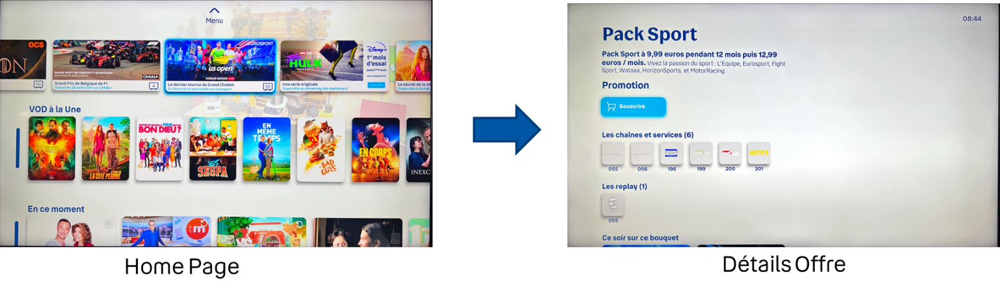{width="7.0055555555555555in" height="2.052263779527559in"}

b.  Solution :

> Retrieving metadata of the featured offer from the local database.

c.  Raisons :

-   Axis does not distinguish between offers eligible and not eligible to the user.

-   If we retrieve offer metadata from KL, there is a risk of displaying offers not eligible to the user.

-   We rely on locally stored offers, and if the offer does not exist in the database (not eligible), we do not display it.

## Find an offer using a specific search (out of scope for the moment)

a.  Scenario (Accessing an offer through a search):

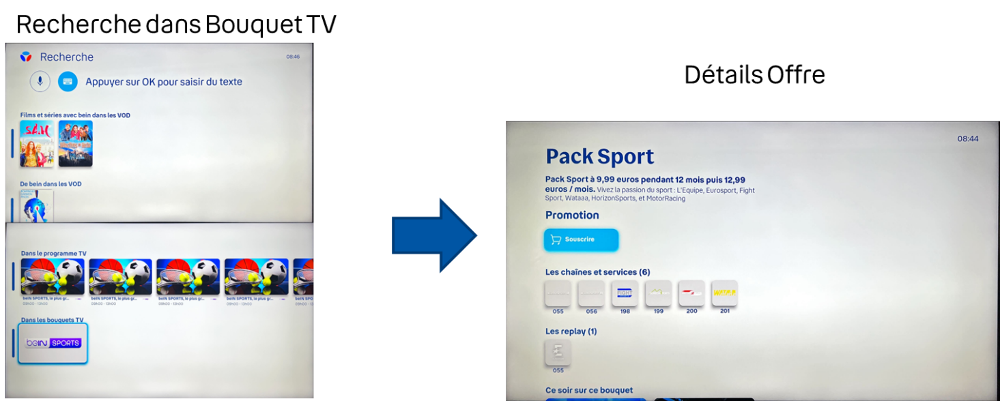{width="6.629517716535433in" height="2.6597222222222223in"}

b.  Solution :

> Search and retrieve offer metadata locally.

c.  Raisons :

-   KL does not distinguish between offers eligible and not eligible to the user after a Ksql search.

-   The search must be done locally to avoid the risk of displaying offers not eligible to the user.

## Retrieve all eligible offers (subscriptions menu)

a.  Scenario (Accessing an offer from the \"My Subscriptions\" menu):

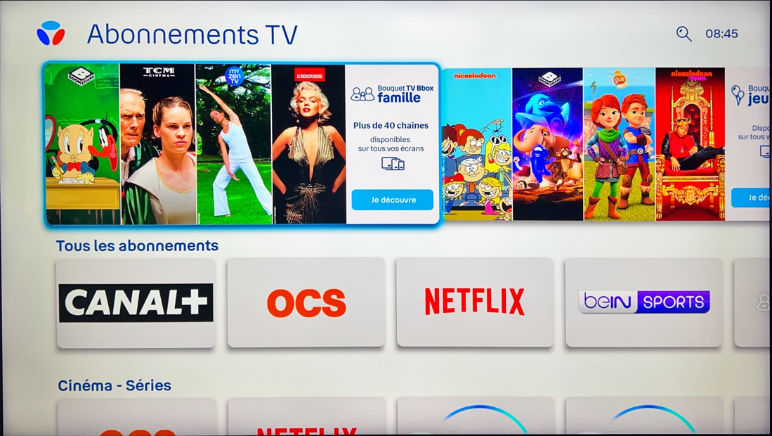{width="3.5083333333333333in" height="1.979238845144357in"}

d.  Solution :

> Retrieve offers as described in section [section 4.1](#retrieving-the-offer-list)

## Retrieve subscribed offers

a.  Scenario (Displaying subscribed offers in the \"My Subscriptions\" menu):

> 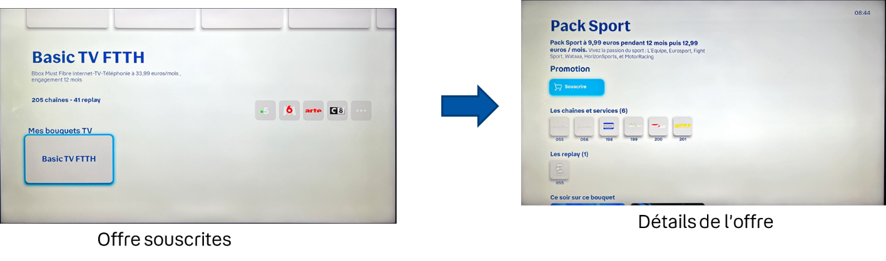{width="6.404861111111111in" height="1.8958508311461066in"}

b.  Solution :

> Retrieve offer metadata locally.

c.  Raisons :

-   The list of subscribed offers is accessible from the \"My Subscriptions\" menu.

-   We are synchronized with the actual status of subscribed offers when entering the \"My Subscriptions\" menu.

## Recovery of offers associated with an unsubscribed channel

***[Scenario (Show offers associated with a chain) :]{.underline}***

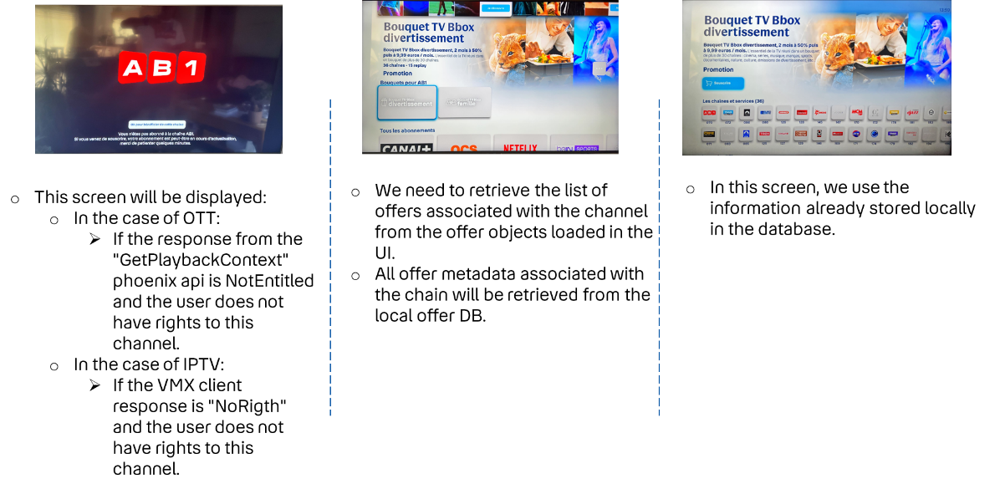{width="5.427777777777778in" height="2.6556681977252845in"}

## Recovery of offers associated with a CUP shop

> ***[Scenario (Show offers associated with a CUP shop)]{.underline}***

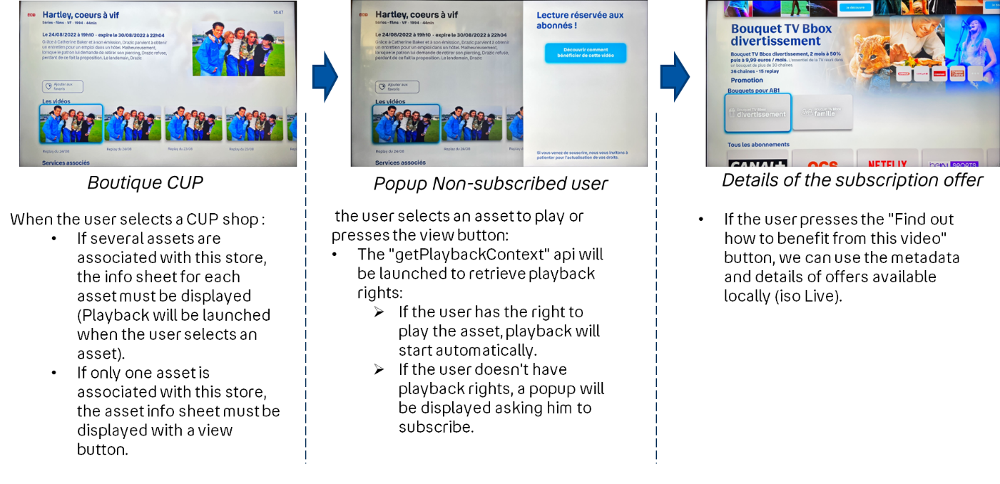{width="6.3619663167104115in" height="3.0833333333333335in"}

## Subscription to an offer

### Subscription process for an offer associated with a live channel and a CUP asset

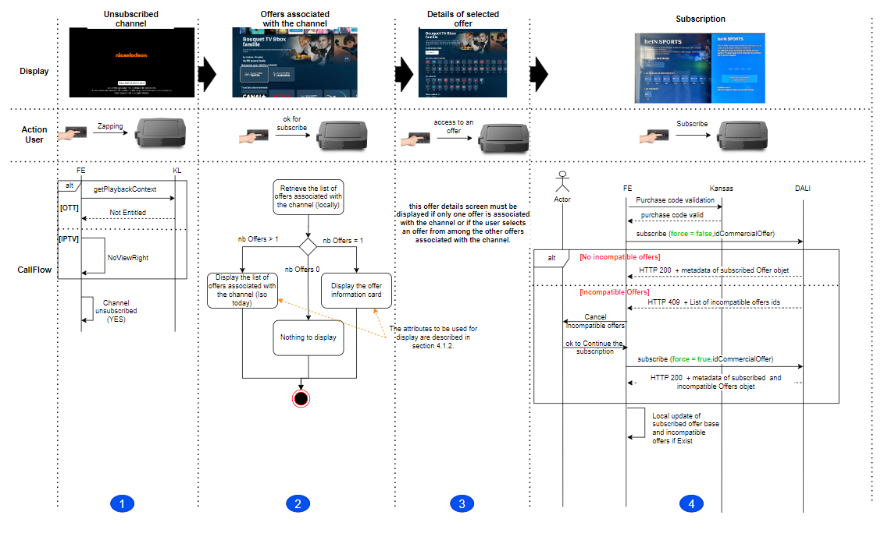{width="6.291666666666667in" height="3.8055555555555554in"}

***[Step 1]{.underline}*** : User zaps to an unsubscribed channel

***[Step 2 :]{.underline}*** The user presses the subscribe button.

In this step, we must :

> o Retrieve the list of offers associated with the channel locally:

-   If the number of offers \> 1

    -   We display the list of offers (as we do today)

-   If the number of offers = 1

    -   The info sheet for the offer associated with the channel must be displayed.

-   If number of offers = 0

    -   Display subscription menu

***[NOTE :]{.underline}***

a)  A single Offer associated with the channel:

Display of offer details is based on locally stored offer metadata. (The metadata to be displayed are iso today)

The Information to be displayed is described in [section 4.1.3](#using-metadata-for-the-ui-interface-1) :

b)  Several Offers associated with the channel

> When the user focuses on one of the Offers, the following is displayed:

-   Offer name

-   Offer description + promotion description

-   Offer image

-   Number and thumbnails of channels associated with the offer

-   Price

-   Number of replay shop

> o Display information retrieval is based on locally stored offer metadata (iso to day)
>
> o If the user selects one of the offers, the information described in a) is displayed.

***[Step 3 :]{.underline}***

-   If only one offer is associated with the channel

    -   This step does not exist

-   Else, if several offers are associated with the channel

    -   We need to display the detailed info card for the offer selected by the user.

***[Step 4 :]{.underline}***

The user presses the subscribe button and enters his purchase code

-   The purchase code must be managed (validated, created, ...with the Kansas platform (iso today).

    -   If the purchase code is valid :

        -   The device must request DALI to launch the subscription action (The subscription API is available in the HAETOS link in the actions.subscribe offer metadata) with the parameter force = false allowing DALI to check the incompatibility of the offer and return to the device the list of incompatible offers if they exist. The device must request DALI to retrieve the (Details and full API path are in the swagger.) :

> ``` http
> POST /api/offers/subscribe
> ```

*[Header]{.underline}* :

| **Parameter**                   | **Value**      | **Comment**                      |
|------------------|---------------------------|---------------------------|
| See [3.1.3](#global-management) |                |                                  |
| `x-purchase-code`               | \$PurchaseCode | Purchase-code filled by the user |

*[Query parameters :]{.underline}*

<table>
<colgroup>
<col style="width: 24%" />
<col style="width: 23%" />
<col style="width: 53%" />
</colgroup>
<thead>
<tr class="header">
<th><em><strong>Param</strong></em></th>
<th><em><strong>Type</strong></em></th>
<th><em><strong>Description</strong></em></th>
</tr>
</thead>
<tbody>
<tr class="odd">
<td><code>idCommercialOffer</code></td>
<td>String</td>
<td>Offer ID DSI</td>
</tr>
<tr class="even">
<td><code>force</code></td>
<td>Boolean</td>
<td><p>Force the subscription without incompatibility offers verfication</p>
<p>Should be <strong>false</strong> for this use case</p></td>
</tr>
</tbody>
</table>

a)  **If the offer is not incompatible with other offers :**

*[Success Response :]{.underline}*

-   `http code 200`

-   The Subscribed offer object This objet is decribed in [section 4.1.2](#principle-of-offer-recovery) (**JSONbody.data Array**)

*[Error Response :]{.underline}*

| **PFSPxyCode**                                       | **HTTPCode** | **JSON.error**        | **Cause**                 | **Action to do**                                           |
|----------|--------|----------------|----------------|-----------------------|
| 1^(1)^                                               | 401          | Invalid Token         | Token is invalid          | Authentication process relaunched.                         |
| \[2-11\]                                             | N/A          | N/A                   | PFSProxy Internal Error   | Just log error, but App goes on.                           |
| 400                                                  | 400          | Bad Request           | Bad Request               | Just log error, but App goes on.                           |
| 404                                                  | 404          | Not Found             | Not Found                 | Just log error, but App goes on.                           |
| 405                                                  | 405          | Method Not Allowed    | Method Not Allowed        | Just log error, but App goes on.                           |
| 409                                                  | 409          | Conflict              | Incompatible offers found | Asks the user to confirm cancellation of compatible offers |
| 429                                                  | 429          | Too many requests     | Too many requests         | Just log error, but App goes on.                           |
| 500                                                  | 500          | Internal server error | Internal server error     | Just log error, but App goes on.                           |
| 502                                                  | 502          | External server error | External server error     | Just log error, but App goes on.                           |
| 503                                                  | 503          | Internal server error | Internal server error     | Just log error, but App goes on.                           |
| Other not HTTP                                       | N/A          | N/A                   | All                       | Just log error, but App goes on.                           |
| Other from APIM: See [REF](#_Oauth_errors_when) \[\] |              |                       |                           |                                                            |

b)  **If the offer is incompatible with other offers :**

::: {#clar-off-009 .review-note}
**À clarifier / valider - CLAR-OFF-009 : incompatibilités et réponse 409.** Aligner la description « list of string » avec l'exemple d'objet contenant `additionalInfo.incompatibleOffers`, après vérification du contrat. Confirmer le libellé de l'action « cancellation of compatible offers » dans le tableau d'erreurs par rapport aux offres incompatibles du parcours, et expliciter l'enchaînement confirmation utilisateur / `force=true` ainsi que le traitement d'une erreur lors de cette seconde requête. Aucun comportement n'est corrigé par supposition.
:::

> *[Success Response :]{.underline}*

-   `http code 409`

-   Body : list of string Incompatible offers list

> Exemple :
>
> ``` json
> {
>   "error": "Incompatible offer",
>   "errorDescription": "The offer is incompatible with one of the subscribed offers",
>   "errorSource": "CLIENT",
>   "additionalInfo": {
>     "incompatibleOffers": [
>       "offerId1",
>       "offerId2",
>       "offerId3"
>     ]
>   }
> }
> ```

1.  The device must ask the user to accept the cancellation of incompatible offers before subscribing to the offer.

2.  If the user confirms subscription to the offer, then the device must request DALI with the api described in (a) (with **[force = true]{.underline}**).

3.  The device receives the metadata of the newly subscribed offer and incompatible offers if exist. In this scenario, the device should update its local database directly without the need for a second call to update the list of offers. (the response structure is defined in the [swagger ref\[1\])](https://tb3-swaggers.hprod.dali.dpps.pub.nbyt.fr/swagger/ui/offermanagement)

> NOTE : The ETAG does not need to be updated at this stage. We\'ll have to wait for the next updater to update it.

## Customer journey adaptation after subscription

::: {#clar-off-010 .review-note}
**À clarifier / valider - CLAR-OFF-010 : compléments au cycle local de TRANSIENT.** La gestion locale de cet état, son démarrage à la souscription et sa sortie à l'expiration des 120 secondes sont confirmés et décrits ci-dessous. Restent à préciser la clé de configuration effective, le comportement après un redémarrage pendant la temporisation et le traitement d'un échec de rafraîchissement ou de droits toujours non propagés après l'expiration. Ces cas ne remettent pas en cause la sortie de `TRANSIENT` à l'échéance.
:::

a)  Objective\
    \
    Subscription rights propagation to channels may take several minutes. This enhancement aims to improve the user experience during this delay, until rights are fully propagated from DSI to KL.

b)  Current Behavior

After subscribing, if a user attempts playback of a newly subscribed channel before rights propagation:

-   A subscription proposal screen is displayed.

> 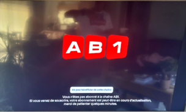{width="3.167108486439195in" height="1.906515748031496in"}

-   The "Souscrire" button remains visible in the offer info sheet.

> {width="3.43798009623797in" height="1.9794433508311462in"}

-   On STB, entitlement retrieval is triggered 30 seconds after subscription via the KL entitlement API.

c)  Changes Introduced

```{=html}
<!-- -->
```
1.  Transient Subscription Status

    -   `TRANSIENT` is a temporary state managed locally by the product (Device), between *not subscribed* and *subscribed*, while the subscription is being processed on the DSI side.

    -   This local waiting state is distinct from the commercial and entitlement statuses received from DALI; it is managed by the product rather than obtained from the API response.

    -   The subscription starts the local waiting timer. Its default duration is 120 seconds; the existing configurable-duration requirement is retained (configuration key example: `default.offers.config.cooldown_in_seconds`).

    -   The product enters `TRANSIENT` when this timer starts and remains in this state until the timer expires. With the default configuration, the product exits `TRANSIENT` after 120 seconds.

    -   Timer expiry ends the local waiting state; it does not, by itself, confirm that DSI processing or entitlement propagation has completed.

    -   Ensures a single reference point for subscription status checks.

2.  Playback Behavior During TRANSIENT

> If the channel belongs to an offer in TRANSIENT state and playback fails:

-   IPTV: returns NORIGHT.

-   OTT Live: getPlaybackContext returns NOT_ENTITLED.

-   System behavior:\
    • Remove the "OK pour souscrire" button.\
    • Display updated message:

    -   New: "  Votre abonnement est en cours d'activation. Nous vous invitons à patienter quelques minute"

    -   Replaces: " Vous n\'êtes pas abonné à la chaîne XXX. 

> Si vous venez de souscrire, votre abonnement est peut-être en cours d'activation. 
>
> Merci de patienter quelques minutes. "
>
> {width="3.1569444444444446in" height="1.8958333333333333in"}

3.  Offer Info Sheet Update During TRANSIENT\
    • Replace "Souscrire" button text with "Souscription en cours".

4.  Entitlement Retrieval

> Adjust entitlement retrieval timer.
>
> After 120 seconds, fetch entitlements for all channels:
>
> ``` http
> POST {{PhoenixURL}}asset/action/list
> ```
>
> Example:
>
> ``` json
> {
>   "apiVersion": "{{apiVersion}}",
>   "ks": "{{kaltura_ks}}",
>   "filter": {
>     "objectType": "KalturaSearchAssetFilter",
>     "kSql": "(and entitled_assets='entitledSubscriptions' asset_type={{Linear_Asset}})"
>   },
>   "responseProfile": {
>     "objectType": "KalturaOnDemandResponseProfile",
>     "retrievedProperties": "id"
>   },
>   "pager": {
>     "pageSize": 500,
>     "pageIndex": 1
>   }
> }
> ```

5.  Offer List Refresh

> Update offers via DALI list API.

-   For this use case:

    -   Do not validate ETag.

    -   Force list refresh.

## Unsubscription of an offer

::: {#clar-off-011 .review-note}
**À clarifier / valider - CLAR-OFF-011 : erreurs et cohérence locale après action.** Compléter la lecture des actions déjà validées dans les tableaux d'erreurs par les conséquences UI et les données locales conservées en cas d'indisponibilité, de réponse vide ou de résultat de souscription/résiliation incertain. Préciser les conditions de relance et leur articulation avec le rafraîchissement différé de l'ETag. Ce point concerne les deux parcours ; il n'ajoute pas de politique de reprise non validée.
:::

***[Call Flow :]{.underline}***

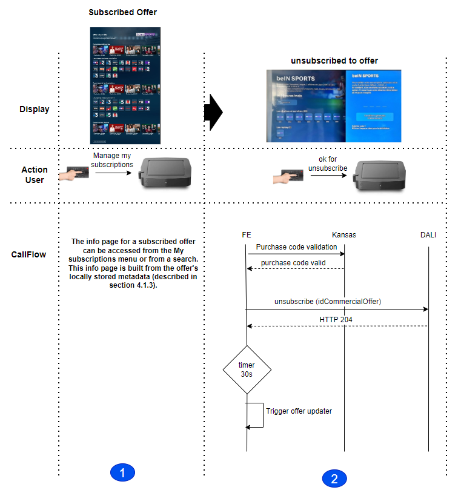{width="4.579348206474191in" height="4.867924321959755in"}

***[Step 1]{.underline}*** : Accessing the information page of a subscribed offer can be done either through the \"My Subscriptions\" menu , through a search, or through HIGHLIGHTED featured subscribed offers. The construction of this sheet relies on the locally loaded metadata, as described in section [4.1.3](#using-metadata-for-the-ui-interface-1)

***[Step 2 :]{.underline}***

i.  The user presses the unsubscribe button and enters his purchase code

    -   The purchase code must be validated with the Kansas platform (iso today)

        -   If the purchase code is valid

            -   The device must request DALI to unsubscribe to the offer(The unsubscription API is available in the HAETOS link in the actions.unsubscribe offer metadata): (Details and full API path are in the swagger.) :

> ``` http
> POST /api/offers/unsubscribe
> ```

*[Header]{.underline}* :

| **Parameter**                   | **Value**      | **Comment**                      |
|------------------|---------------------------|---------------------------|
| See [3.1.3](#global-management) |                |                                  |
| `x-purchase-code`               | \$PurchaseCode | Purchase-code filled by the user |

*[Query parameters :]{.underline}*

| ***Param***         | ***Type*** | ***Description*** |
|---------------------|------------|-------------------|
| `idCommercialOffer` | String     | Offer ID DSI      |

*[Success Response :]{.underline}*

-   `http code 200`

-   unsubscribed offer metadata (metadata of offers impacted by this action)

    -   Metadata of the unsubscribed offer :

        -   The device should update its local database for this unsubscribed offer y without the need for a second call to update the list of offers. (the response structure is defined in the [swagger ref\[1\])](https://tb3-swaggers.hprod.dali.dpps.pub.nbyt.fr/swagger/ui/offermanagement)

> NOTE : The ETAG does not need to be updated at this stage. We\'ll have to wait for the next updater to update it.

*[Error Response :]{.underline}*

| **PFSPxyCode**                                       | **HTTPCode** | **JSON.error**        | **Cause**               | **Action to do**                   |
|----------|--------|----------------|----------------|-----------------------|
| 1^(1)^                                               | 401          | Invalid Token         | Token is invalid        | Authentication process relaunched. |
| \[2-11\]                                             | N/A          | N/A                   | PFSProxy Internal Error | Just log error, but App goes on.   |
| 400                                                  | 400          | Bad Request           | Bad Request             | Just log error, but App goes on.   |
| 404                                                  | 404          | Not Found             | Not Found               | Just log error, but App goes on.   |
| 405                                                  | 405          | Method Not Allowed    | Method Not Allowed      | Just log error, but App goes on.   |
| 429                                                  | 429          | Too many requests     | Too many requests       | Just log error, but App goes on.   |
| 500                                                  | 500          | Internal server error | Internal server error   | Just log error, but App goes on.   |
| 502                                                  | 502          | External server error | External server error   | Just log error, but App goes on.   |
| 503                                                  | 503          | Internal server error | Internal server error   | Just log error, but App goes on.   |
| Other not HTTP                                       | N/A          | N/A                   | All                     | Just log error, but App goes on.   |
| Other from APIM: See [REF](#_Oauth_errors_when) \[\] |              |                       |                         |                                    |
:::

```{=html}
<style>
.versions th:nth-child(-n+2), .versions td:nth-child(-n+2) { text-align: center; }
.review-note { margin: 3mm 0; padding: 2mm 3mm; border-left: 2px solid #707070; background: #f4f4f4; color: #333; font-size: 9pt; line-height: 1.3; break-inside: avoid; }
.spec-contents ul { list-style: none; padding-left: 5mm; margin: 1mm 0; }
.spec-contents > ul { padding-left: 0; }
.spec-contents li { font-size: 9pt; margin-bottom: 1mm; }
.technical-content h1, .references h1 { margin: 0 0 6mm; font-size: 16pt; }
.technical-content h2 { margin: 6mm 0 3mm; padding: 0; font-size: 13pt; text-align: left; }
.technical-content h3 { margin: 5mm 0 3mm; font-size: 11pt; }
.technical-content h4, .technical-content h5, .technical-content h6 { margin: 4mm 0 2mm; font-size: 10pt; }
.technical-content h1, .technical-content h2, .technical-content h3, .technical-content h4, .technical-content h5, .technical-content h6 { break-after: avoid; padding: 0; font-weight: bold; font-style: normal; text-align: left; line-height: 1.25; }
.technical-content .header-section-number, .references .header-section-number { display: inline-block; margin-right: 0.75em; }
.technical-content table { margin: 3mm 0 5mm; font-size: 8pt; line-height: 1.3; }
.technical-content th, .technical-content td { padding: 1.2mm 1.6mm; vertical-align: top; }
.technical-content td p, .technical-content th p { margin: 0 0 0.8mm; }
.technical-content td p:last-child, .technical-content th p:last-child { margin-bottom: 0; }
.technical-content td ul, .technical-content td ol { margin: 0.5mm 0; padding-left: 4mm; }
.technical-content td blockquote { margin: 0; padding: 0; border: 0; }
.technical-content code { font-family: "DejaVu Sans Mono", monospace; font-size: 8pt; white-space: normal; overflow-wrap: anywhere; }
.technical-content pre { margin: 3mm 0; padding: 2.5mm; background: #f3f4f4; border: 0.5pt solid #c5cbcb; font-size: 8pt; line-height: 1.35; }
.technical-content pre code { white-space: pre-wrap; }
.technical-content img { max-width: 100%; max-height: 205mm; height: auto !important; object-fit: contain; }
.technical-content .document-header img { width: 34mm; }
.technical-content blockquote { margin: 3mm 0 3mm 4mm; }
.technical-content pre { white-space: pre-wrap; overflow-wrap: anywhere; }
.technical-content p { orphans: 3; widows: 3; }
.technical-content .mark, .technical-content mark { background: transparent; color: inherit; }
</style>
```
